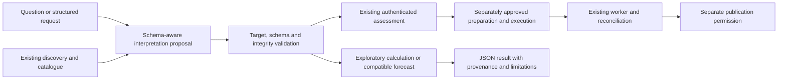

# Business prediction framework architecture

Design baseline: **2 November 2026**. Status: **proposed architecture; implementation and data execution are not authorized by this document**.

The proposed framework is a general-purpose ML/data backend. It discovers authorized data, grounds structured prediction requirements in evidence, checks readiness, and supports separately approved preparation, model development and inference. It accepts previously unseen objectives through semantic and capability contracts, without predefined business questions, scenarios or question-to-dataset/model routes. A new request does not guarantee a derivable target, adequate history or an available trained model.

[Architecture diagram](business_prediction_framework_architecture.png)

## 1. Repository baseline and evidence

### Current query integration (3 November 2026)

The baseline below describes the earlier design snapshot. The current request
entry point is `DynamicBusinessQueryService`, documented in the
[dynamic query integration guide](../development/dynamic_business_query.md).
It now connects existing catalogue discoveries, prepared-data metadata, explicit
analytical plans, and compatible model inference. Structured requests support
grouping, filtering, comparison, ranking, observed series, change and anomaly
analysis. Natural-language interpretation can be supplied by a provider-neutral
JSON callback; the local fallback remains conservative.

The local query path does not promote exploratory outputs. An approved request
still uses current semantic/specification/execution controls. The existing worker
can be called only for an already authorized execution; recovery and publication
retain their existing gates. The actual-data validation reused the two existing
confirmed-date subset regressors and preserved all original sources and models.

### Existing implemented capabilities

The repository contains a configured Python/Jupyter workspace, four executed assessment notebooks, source-specific assessment implementations, and validated evidence/report generation. Inspection found seven Python files under `src/data/`; `src/features/`, `src/training/` and `src/prediction/` have no implemented prediction framework. Saved notebook outputs contain no execution errors; notebooks were inspected, not rerun for this design.

| Existing artifact | What it establishes | Boundary for this design |
| --- | --- | --- |
| [Inventory notebook](../../notebooks/01_data_inventory.ipynb), [validation report](../../reports/data_inventory/inventory_validation_report.md), [evidence workbook](../../reports/data_inventory/validation/inventory_validation_evidence.xlsx) | Source census, layouts, raw headers/types, formula inspection, date and identifier diagnostics | Profiling is implemented; general database onboarding and semantic interpretation are proposed |
| [Quality notebook](../../notebooks/02_data_quality_analysis.ipynb), [quality report](../../reports/data_quality/data_quality_report.md), [issue register](../../reports/data_quality/issue_register.csv) | Full-table quality assessment and unresolved exceptions | Flags and diagnostic parsing do not authorize corrections |
| [Relationship notebook](../../notebooks/03_dataset_relationship_analysis.ipynb), [relationship report](../../reports/analysis/dataset_relationship_report.md), [matrix](../../reports/analysis/identifier_relationship_matrix.xlsx), [granularity workbook](../../reports/analysis/dataset_granularity_report.xlsx), [logical model](../../reports/analysis/data_model_diagram/README.md) | Candidate identities, source overlap and controlled diagnostic join evidence | No business primary key, authoritative source or production join is confirmed |
| [Feasibility notebook](../../notebooks/04_business_prediction_feasibility.ipynb), [feasibility report](../../reports/analysis/business_prediction_feasibility_report.md), [target mapping](../../reports/analysis/prediction_target_mapping.xlsx), [requirements](../../reports/analysis/prediction_data_requirements.xlsx) | Supported versus missing outcomes, historical limitations and reusable capability requirements | Illustrative assessments are documentation, not executable request routes |
| [Preparation strategy](../../reports/analysis/data_preparation_strategy.md), [36-rule register](../../reports/analysis/business_rule_register.xlsx), [cleaning specification](../../reports/analysis/data_cleaning_specification.xlsx), [dataset blueprint](../../reports/analysis/training_dataset_blueprint.xlsx) | Proposed treatments, structural dataset families, approvals and leakage safeguards | No preparation runtime or approved training dataset exists |
| [Clarification brief](../../reports/analysis/initial_prediction_business_clarification.md), [readiness workbook](../../reports/analysis/initial_prediction_readiness_checklist.xlsx) | Thirteen core and four conditional owner decisions; fifteen stage checks | No recorded business approval or training readiness |

The current evidence covers **17 files: 14 Excel workbooks / 17 worksheets and 3 GST CSV tables; 20 tables, 521 fields, 135 identifier candidates and 37 date-related fields**. Those counts describe this evidence baseline and impose no framework limits. Existing code contains NOP-specific filenames, field bindings and assessment expectations; reuse its findings and validation ideas, not its source-specific branches as a general runtime. Existing report generators can overwrite their own outputs when rerun, so future orchestration must not invoke them as an implicit prediction dependency.

### Evidence that constrains the architecture

| Confirmed technical observation | Required design response |
| --- | --- |
| 203,455 ambiguous date-field values, 28 impossible dates and 14,949 possible Excel serial values remain unresolved | Record raw values, competing interpretations, epoch/century uncertainty and owner decisions; no global parser or silent date resolution |
| Three excess exact duplicates and 972 excess payload candidates remain; these are not counts of all participating rows | Distinguish excess occurrences, duplicate groups and affected rows; require grain/occurrence policy before any derivative treatment |
| Large invoice/order diagnostic linkage expanded 100,188 rows to 402,400, and raw quantity 363,277 to 1,472,651 | Validate cardinality, grain changes and measure conservation before releasing a join; never accept fanout as new activity |
| Scoped GST/invoice document linkage expanded 337 to 609; scoped document plus description aligned 337 to 337 only in the inspected extracts | Alternate representations must not become additional events; empirical line alignment is not a persistent business key |
| Grouped inventory movements often lack raw item context; repeated document totals are not line-additive | Require explicit layout, identity and measure roles; do not infer fill-down or summation semantics |
| Synthetic markers, unconfirmed source precedence and an unnamed populated PCT_NOPJ field remain | Separate production eligibility from schema validity; retain raw unnamed-field positions without inventing meaning |
| Small invoice evidence has 337 lines / 234 references, 107 ambiguous dates and ten partially observed months | The first discussion candidate remains conditional; line count is not temporal sample size or proof of annual seasonality |

These observations come from the linked quality, relationship and clarification artifacts. All **424 existing issue entries remain unresolved as recorded**; this design neither revises the issue register nor combines overlapping issue counts into a unique bad-record count. The invoice-volume candidate is an evidence example, not a platform constraint. Propensity still lacks a verified historical eligible population, mature negative outcomes and a defensible window; inventory still lacks approved context/state semantics. No training readiness is claimed.

## 2. Design decisions and system boundaries

| Decision | Proposed choice and reason |
| --- | --- |
| Application shape | Begin with a modular backend with explicit interfaces and separately runnable jobs. Separate logical responsibilities without requiring microservices, a broker or a distributed platform |
| External integration | A teammate's LLM/MCP/UI layer submits structured drafts and consumes structured results. The backend does not interpret free text, host a chatbot or depend on an LLM provider |
| Discovery versus meaning | Automate structural discovery and evidence collection; approve business meaning through versioned owner decisions. Similar names, uniqueness and overlap cannot establish semantics |
| Binding | Reusable operators consume opaque source/table/field references and approved role bindings. Actual names and target-specific rules reside in metadata, never core branches |
| Planning versus execution | Produce an auditable dependency plan first. Separate authorization is required for discovery scope, preparation, dataset construction, feature work, training, release and inference |
| Dataset construction | Build immutable, target-specific observation views; use separate reference, event/detail, document, state/flow, temporal and decision/outcome views when justified. No universal merged training table |
| Task and method selection | Infer technical problem requirements from the approved estimand and evidence, then filter extensible algorithm capabilities. No universal forecasting method or question-to-model lookup |
| Model reuse | Require semantic, schema, unit, population, horizon and validation-domain compatibility. An unseen objective may require a new approved training project, not reuse of an unrelated model |
| Storage and orchestration | Define logical registries, artifact storage and job state; select physical storage and execution technology later. Existing files are evidence inputs, not a concurrent production registry |
| Dependencies | Reuse the existing scientific Python stack where suitable in future implementation. Installed libraries do not establish model suitability. Add connectors or infrastructure only for demonstrated source, scale, security or operational needs |

The core may maintain target definitions, approved bindings, feature/input specifications, algorithm capabilities and trained-model metadata. These describe what data and artifacts mean. They must never associate anticipated request wording with a dataset, answer or model. Previously unseen requests can compose existing capabilities; a fundamentally new task or source protocol may require a new extension, while incomplete evidence produces a blocker.

## 3. Components, interfaces and dependencies

**Every C-component below is proposed.** Existing scripts are evidence producers; they do not implement these production responsibilities. Logical registries may share storage and components may run in one process initially.

| ID / component | Responsibility and expected input | Output and dependencies |
| --- | --- | --- |
| C01 Source adapters and onboarding | Read authorized file/database sources, describe structure, obtain consistent snapshots and expose bounded read interfaces; input source descriptor and access grant | Versioned source metadata and read handles to C02/C07. Depends on C15; no write access to originals |
| C02 Schema and evidence catalogue | Discover tables, fields, layouts, physical/logical type alternatives, identifiers, relations, temporal support and quality; input C01 snapshot | Schema discovery results, evidence references and drift events. Supplies C03/C04/C05; retains declared versus observed constraints separately |
| C03 Semantic, rule and approval registry | Bind fields to business roles, units, identity scope, time roles and rule decisions; record accountable owner decisions and operation approvals | Versioned semantic bindings, approved relationship/target/treatment contracts and unresolved decisions. Uses C02; gates C05–C12; evidence never self-approves |
| C04 Structured requirement and target assessor | Validate an external requirement, resolve authorized bindings and compare derivation alternatives without executing them | Requirement/target assessment or precise clarification. Uses C02/C03/C15; sends grounded candidates to C05 |
| C05 Feasibility, readiness and plan validator | Check target evidence, history, cohort/outcome validity, identity, dependencies, leakage, approvals and costs; classify analytics versus prediction | Stage readiness, blocker graph and immutable dependency plan, or non-success response. Uses C02–C04/C15; routes authorized work to C06 or compatible serving via C11/C12 |
| C06 Execution coordinator | Schedule only explicitly authorized operations in a validated plan; pin versions, budgets and job state; handle retries/cancellation | Auditable job results and stage transitions. Uses C03/C05/C15; dispatches C07–C10. Planning or inference requests cannot launch training implicitly |
| C07 Preparation and dataset constructor | Bind reusable approved parsing, identity/context, relational, observation and outcome operators to a plan | Immutable raw-linked derivatives, training dataset metadata and exception/conservation evidence. Uses C01–C03/C05/C06; no permanent source mutation |
| C08 Feature and preprocessing manager | Validate input roles, availability, fit scopes, train/serve parity and leakage; later fit/apply approved transforms | Feature specification, fold-specific fitted artifacts and compatible input views. Uses C07/C03; fitting occurs inside C10 training folds |
| C09 Problem and method planner | Identify technical learning structure and filter candidate/baseline capabilities by target/data/constraints | Explicit task type, admissible method candidates, exclusion reasons and search budget. Uses C04/C05/C07/C08; no keyword/model routes |
| C10 Training, evaluation and validation | Execute authorized candidate comparison, leakage controls, final evaluation and artifact validation | Training artifacts, measured evaluation results and release recommendation, never automatic acceptance. Uses C06–C09 and approved protocol |
| C11 Model registry and lifecycle | Track immutable versions, compatibility domain, evaluation evidence, approvals, promotion, suspension and retirement | Compatible released artifact reference or no-compatible-model reason. Uses C03/C10/C15; does not train on a cache miss |
| C12 Inference runtime | Validate serving scope, input availability, schema, units, fitted transforms and model compatibility before prediction | Versioned numerical/categorical/other supported outputs with per-item status. Uses C05/C07/C08/C11/C15; serving never fits transforms or learns silently |
| C13 Result and explanation interface | Return structured analytics, predictions, clarification or failure with evidence, lineage and limitations | Transport-neutral responses to the teammate's layer. Uses C04/C05/C10–C12; cannot invent confidence or manual business answers |
| C14 Audit, monitoring and reproducibility | Record immutable lineage, operation state, approvals, freshness, drift and delayed outcome performance | Audit/run manifests, alerts and review/suspension recommendations. Receives events from all components; any approved updates return to C02/C03/C11 |
| C15 Authorization and resource policy | Enforce caller/purpose/data/department/model/operation scope and resource limits at every access and stage | Trusted authorization decisions and bounded execution grants. Cross-cutting; derives caller identity from trusted integration context, not submitted text |

Dependencies are explicit and versioned. C02 holds observations; C03 holds accepted meanings and approvals. C05 can inspect candidate evidence without authorizing C07. C09 may propose methods before dataset construction, but must reassess against the accepted dataset before training. C13 reports technical reasoning; it does not decide business meanings. C14 monitoring cannot silently approve replacement data, retrain or promote a model.

## 4. Source onboarding and schema intelligence

1. Register an owner, purpose, authorization scope, supported adapter and opaque source ID. Credentials are secret references, never contract payloads or logs. Discovery permission is separate from permission to use data for training or inference.
2. Capture an immutable file version/hash or a database snapshot/transaction watermark with consistency guarantees. Hashes establish byte identity, not production authenticity or complete business history. Without a repeatable snapshot, record the limitation and block reproducibility-dependent release.
3. Enumerate only authorized containers and fields. Database-declared constraints are evidence supplied by the source, not automatically approved cross-system business identity. New protocols use adapter extensions, not source-name checks in core code.
4. Detect file layouts, possible header rows, blank/duplicate headers, merged regions, formula cells/cache availability and mixed record roles. Preserve physical positions and original types/tokens. Ambiguous layouts yield alternatives and owner questions. Spreadsheet formulas and external links are inspected as data, never executed by discovery.
5. Profile missingness, type alternatives, identity formats, uniqueness, scoped overlap, date interpretations, coverage and measure distributions. Record denominator, population, snapshot, method, sampling scope and uncertainty. Samples support hypotheses; release-critical uniqueness/cardinality/completeness assertions require full relevant-population checks or explicit limitations and an approved bounded scope.
6. Assign technical source/table/field IDs within a versioned schema. These are metadata references, not invented business keys. Preserve source name/path/position as lineage. Rename/reorder detection proposes a mapping; meaning-preserving equivalence requires explicit review rather than silent rebinding by name or position.
7. Record relationship hypotheses with scope, raw/normalized representation, null semantics, overlap/cardinality and temporal conditions. Keep unsupported and negative evidence. Never select a join solely from a column label or high matching percentage.
8. Publish a versioned evidence snapshot. Compute dependency impacts for schema, unit, identity, layout, semantic and freshness changes; invalidate affected bindings, approvals or plans before execution as necessary.

Metadata is organized around sources, schema versions, field roles, entity/key namespaces, candidate/approved relationships, clocks/calendars, measures/units, quality findings, source authority, semantic decisions, artifacts and access policies. Each assertion carries `observed`, `hypothesized`, `proposed`, `approved`, `rejected` or `superseded` status, provenance and scope. Statistical confidence in an observation is distinct from business approval and predictive uncertainty.

Extendable semantic vocabularies may describe new departmental concepts; there is no mandatory fixed business-entity list. The catalogue stores descriptions and accepted role bindings, not a list of permissible questions. Sensitive samples remain access-controlled; cross-department metadata disclosure itself requires permission.

## 5. Requirement grounding, target discovery and readiness

An external structured requirement may be partial. C04 checks outcome meaning, entity/population, measure, time role, requested granularity, unknown-versus-observed status, constraints and decision utility. It proposes field bindings using authorized metadata and approved semantics, retaining alternative interpretations and their evidence. Missing meaning produces a focused clarification, not an arbitrary default.

Target discovery proposes a versioned derivation expression over approved roles and operators. Expressions must specify input measure, unit, grain, eligibility, lifecycle treatment and observation support. A similarly named field does not establish a usable target; an outcome may need missing lifecycle sources, an unavailable historical population or business approval. The expression is a design/plan artifact until execution is authorized. No target values are generated by assessment.

| Gate | Required evidence | Failure behavior |
| --- | --- | --- |
| Authority and access | Production/synthetic status, authoritative version, business use and caller permissions | Deny access or request owner decision; no newest/largest-source rule |
| Target and grain | Approved outcome/measure, identity scope, record-to-observation meaning and lifecycle policy | Return ambiguous/unsupported target with exact missing definition |
| Time and observation | Relevant dates/format/calendar, event/available clocks, complete capture, mature follow-up and horizon where applicable | Preserve alternatives; return insufficient history/coverage or unresolved rule |
| Identity and dependency | Required scoped IDs, approved crosswalks/joins, cardinality, availability and unmatched policy | Block only affected dependency; prefer a sufficient single source when supported |
| Quality and treatments | Scope-specific requiredness, duplicate/exception policy and authorized treatments | Keep raw exceptions; require approval or document accepted bounded limitations |
| Evaluation and leakage | Appropriate independent observations, permissible predictors, split protocol, business utility and baseline | No training if honest evaluation or target-time availability cannot be established |
| Serving compatibility | Released artifact matches target semantics, input contract, domain, horizon and current readiness | No-compatible-model or out-of-domain result; never substitute another outcome |

Readiness is a stage-specific result, not a global percentage. Use technical feasibility classifications **Feasible / Feasible with Conditions / Not Currently Feasible** alongside separate readiness and authorization fields. Feasible does not mean authorized, trained or production-ready. A bounded parser treatment can be approved before a forecast horizon is settled; building/evaluating that forecast cannot. Resolve only dependencies relevant to the chosen contract: inventory, GST and finance rules are not universal gates.

History sufficiency depends on the target grain, independent observations, horizon, folds, seasonality, class outcomes and intended use. No fixed table count, row threshold or minimum-month constant belongs in core. For classification, require a defensible eligible population, positive/negative definitions and mature observation; absent events or unmatched accounts are not negative labels. Preserve unknown and censored states. For unknown numerical outcomes, require comparable historical inputs and measured outcomes available at the intended decision, not merely an amount column.

## 6. Rules, approvals and reusable preparation

The existing 36 rules remain the NOP decision baseline, unchanged. Future C03 generalizes their decision structure, not their source-specific text. Authority, identity, time, target/measure, optionality, duplicates and relationship decisions must retain their owner and evidence. Existing technical observations and project constraints must not be relabeled business-approved definitions.

A decision moves through proposed/unresolved review to approved or rejected, then may be revoked or superseded. Execution authorization is a separate record specifying operations, purpose, exact semantic/source/plan versions, treatment scope, approver authority and validity. An external `approved=true` flag is insufficient; the backend verifies a trusted approval record. Relevant source/meaning/treatment changes require impact review. Do not invalidate unrelated approvals unnecessarily, and do not reuse an approval outside its recorded scope.

Proposed C07 operators consume typed role bindings and configuration:

| Operator family | Required contract and safeguards |
| --- | --- |
| Layout and record classification | Approved header/group boundaries and raw lineage; no arbitrary fill-down or invented field names |
| Typed representation | Per-field grammar/locale/epoch/unit and approved normalization; raw token, parsed alternative and exception status coexist |
| Identity and occurrence | Scoped composite identity/crosswalk plus explicit event-versus-line and duplicate treatment; row ordinals remain technical locators |
| Relational construction | Approved keys and effective/available-time predicates; nulls do not match nulls; verify eligible target uniqueness, unmatched policy and expected row multiplicity |
| Observation and measure construction | Approved event/detail/document/state grain, additive versus repeated/cumulative measures, calendar/exposure and missing-versus-zero policy |
| Decision and outcome construction | Approved population, decision time, horizon if relevant, follow-up/lag, outcome and censoring; unknown observations remain explicit |
| Derivative validation and release | Account for accepted/excluded/exception records; verify lineage, schema, grain, counts and applicable quantity/financial controls before owner release |

Plans are dependency graphs of these operations, not a universal pipeline for every task. One-to-many or many-to-many changes require an explicitly approved new grain or allocation; raw value equality cannot authorize them. Store unparsed, unmatched, conflicting and out-of-scope records in lineage/exception evidence without rewriting originals or silently losing them. A legitimate target-specific eligibility filter is documented, approved and reconciled, not described as source deletion.

Preparation emits immutable dataset versions and manifests. Fitted imputers, scalers, encoders, feature selectors and similar learned treatments belong inside training folds, not a global pre-split cleaning pass. Deterministic approved parsing may precede splits only when it uses no future distribution/outcome information. Each target gets an observation/input contract; different targets can share approved intermediate views without sharing incompatible labels, populations or grains.

## 7. Feature engineering and leakage controls

C08 defines features by roles, lineage, unit, availability and fit behavior, with actual source references bound through metadata. Target-specific configuration is necessary and permitted; dataset-specific assumptions inside a generic operator are not.

For each feature, record event time, effective interval, ingestion/available time, permitted decision cutoff, lookback, missingness and transformation. Historical reconstruction must show what was knowable then, not just what a current export says. Current states and later corrections cannot become historical inputs without evidence. Future covariates are admissible only when their values were known at the relevant decision and that use is evaluated.

Split related event/line/alternate-export occurrences together and preserve intended time order. For future decisions, use chronological development folds and an untouched final future holdout; training outcomes must mature, including reporting delay, before the fold cutoff. Purge overlapping outcome windows or apply an embargo where the window structure requires it, not an arbitrary universal gap. If the estimand is genuinely non-temporal and deployment samples are exchangeable, an explicitly justified grouped/stratified design may be suitable; no random-line default.

Fit all learned transformations, target encodings, feature selection and tuning only on training portions. Evaluation data must not influence parsing policy choice, thresholds or hyperparameters. Reject target components available only after the decision; deterministic reconstruction of a known value belongs to analytics. Package fitted preprocessing with the model to enforce training/serving parity. These are future requirements; no features or splits are generated now.

## 8. Task classification, algorithm selection and evaluation

The following are extensible technical task families, **not business scenarios or question mappings**.

| Evidence-defined task | Method eligibility and evaluation requirements |
| --- | --- |
| Historical retrieval, aggregation or deterministic arithmetic | Use authorized analytical/rule operations when sufficient. Return observed/calculated results, not predictions or fabricated forecast metrics |
| Forecasting an ordered future numerical/count process | Complete scoped series, approved buckets/horizon and mature history; compare suitable naive/statistical and supervised lagged/global candidates only where their inputs and support exist |
| Unknown numerical outcome regression | Comparable labeled observations and decision-time inputs; compare compatible regression baselines/candidates and evaluate at deployment grain |
| Classification, including propensity | Approved class/positive/negative definitions, population, label maturity and independent splits; evaluate error costs, class support, probability calibration if needed and operating thresholds selected on development data |
| Duration or time-to-event | Verified origin/event/censoring and follow-up; require task-appropriate methods and censoring-aware evaluation, otherwise unsupported |
| Anomaly, ranking or other extensions | Require an explicit objective, observation structure and suitable validation/utility. Unsupervised scores are not fraud probabilities; ranking needs defensible relevance/feedback evidence |

C09 first determines whether ML is necessary. It filters method plugins by task, output type, data representation, independent sample support, series structure, missingness handling, censoring, horizon, extrapolation constraints, explainability, compute and required uncertainty. Candidate capability descriptors contain preconditions and supported contracts, not business wording. Selection is a documented proposal before training and an evidence-based comparison after approved evaluation. New algorithms need registered fit/predict/validation behavior and conformance tests; no automatic library import implies support.

C10 requires a frozen training request, versioned data/features, approved protocol and budget. Compare non-ML and simple predictive baselines when meaningful, fit within folds, and reserve final holdout results for release assessment rather than repeated selection. Report per-fold and relevant subgroup/horizon results, support, failures, units, class imbalance and stability. Choose error metrics and business acceptance thresholds before final evaluation; do not invent universal accuracy targets. Predictive intervals, probabilities or confidence claims require relevant out-of-sample validation; otherwise return uncertainty as unavailable with a reason.

Include runtime/input-schema tests, inference parity, reproducibility limits and deployment-domain coverage in model validation. High aggregate scores cannot erase unsupported groups or horizons. Observational predictive evidence does not establish causal effects or support counterfactual interventions without additional assumptions/design. No algorithm is selected and no performance, model or uncertainty value is produced in this task.

## 9. Proposed technology-neutral contracts

These are **design specifications only**, not implemented schemas, API endpoints or executable payloads. Collections are open-ended unless a versioned contract defines an enum. References resolve only within the authorized catalogue. Use explicit null/unknown/omitted semantics; an unavailable value is never encoded as zero.

### Shared reference and envelope conventions

All contracts carry `contract_type`, `contract_version`, `object_id`, `object_revision`, `created_at`, `purpose_scope`, `owner_reference`, `evidence_references` and `dependency_versions`. Operation envelopes add `request_id`, `correlation_id`, trusted `authorization_context_reference`, `operation`, `status`, `warnings` and `issues`. Persisted revisions are immutable; statuses and supersession are audited. Optional fields and task-specific extensions are declared by contract version, not inferred from arbitrary payload keys.

A `FieldReference` contains `source_id`, `source_version`, `schema_version`, `table_id`, `field_id` and its original locator; actual field names are metadata. A `SemanticBinding` adds role/concept, grain, namespace, unit/currency, time role, validity, rule/approval references and status. An `EvidenceReference` identifies artifact/version/location, observation method, relevant population/count unit, snapshot, completeness/sampling and interpretation limits. A `RelationshipContract` identifies key bindings, direction, semantic scope, representation treatment, effective/available-time predicates, expected cardinality, null/unmatched/fanout policy, conservation tests and approval. No reference grants access by itself.

| Contract | Required content beyond the shared envelope | Producer → consumers; acceptance rule |
| --- | --- | --- |
| DataSourceMetadata | Adapter kind/version; access/secret references; owner; physical resource locator; permitted purpose/operations; snapshot/watermark/hash and consistency; extraction scope/as-of; freshness; sensitivity; retention; authority and synthetic status | C01 → C02/C07/C15. Locator and credentials are authorized; unknown production authority remains unknown |
| SchemaDiscoveryResult | Source snapshot; containers/fields/positions/raw headers; declared and observed types; layouts/alternatives; key/relation hypotheses and scope; date alternatives/clocks/coverage; quality findings/denominators; profiling scope; failures; discovery version | C02 → C03–C05. Partial scans explicitly list uninspected resources; hypotheses are not approved bindings |
| PredictionRequirementSpecification | Business objective description; observed-versus-unknown outcome; candidate outcome/entity/metric roles; population; requested granularity; as-of/decision time; horizon/calendar where relevant; constraints/utility; proposed bindings and unresolved terms | External layer/C04 → C05. Description is not an instruction to execute SQL/code; missing critical semantics returns clarification |
| TargetAssessment | Requirement revision; candidate approved-binding references; proposed derivation expression; target type/unit/grain; lifecycle/eligibility; event/availability/decision clocks; maturity/censoring; required dependencies; evidence alternatives; approval status | C04 → C03/C05/C09. Explicitly records derivable, conditional, ambiguous or unsupported; no generated labels |
| FeasibilityReadinessAssessment | Target revision; technical feasibility class; stage-specific readiness and execution authorization; applicability of gates; blockers/owners; independent observation/history/outcome evidence; proposed dependency plan/hash; estimated limits; expiry/revalidation triggers | C05 → C06/C11/C13. No execution unless the relevant stage is ready and separately authorized |
| DataPreparationApproval | Exact source/schema/semantic/target/plan versions; rule decisions; permitted operations/projections/treatments/joins; accepted exceptions and validation tolerances; purpose; authorized approver/authority; decision/effective/expiry/revocation; execution grant reference | C03 → C05–C07/C15. Verified owner decision and execution permission, not caller assertions; changed scope requires review |
| PreparationPlanAndResult | Operator graph and versions, approved bindings/parameters, required grants, expected grains/cardinalities, exception policies and validation controls; result adds input/output manifests, lineage, counts, checks, failures and release status | C05/C07 → C06/C08/C14. Plans do not count as execution; failed conservation/contract checks block release |
| TrainingDatasetMetadata | Immutable dataset/version/locator/hash; source and plan lineage; observation/entity grain; population; target semantics; input/target roles; units; history/calendar/capture/maturity; availability; exception coverage; quality/release evidence; split/group eligibility; permitted purpose | C07 → C08–C10. No universal dataset; snapshot completeness and approved target remain required |
| FeatureSpecification | Feature IDs/versions; input role bindings; expression/operator graph; time/lookback/availability; units; missing/unknown/category handling; label dependencies forbidden; fit-required flag; fold protocol; output schema; fitted artifact references; train/serve compatibility | C08 → C09/C10/C12. Inputs are admissible at decision time; unfitted plans cannot masquerade as fitted artifacts |
| ModelTrainingRequest | Dataset/target/feature versions; task family; candidate capability references; baseline and tuning space; validation/split/group/maturity protocol; metrics/utility/acceptance criteria; budget/seeds/environment; execution approval and job/idempotency references | C06/C09 → C10. Reject stale, unapproved or infeasible requests; never created implicitly by inference |
| ModelEvaluationResult | Run/candidate/baseline IDs; protocol and fold/holdout manifests; measured metrics with support/units; subgroup/horizon/class results; calibration/interval tests if applicable; leakage/parity checks; reproducibility limits; failures; intended-use recommendation | C10 → C03/C11/C13. Values must trace to actual evaluation; unavailable results are explicit, not synthetic scores |
| ModelRegistryEntry | Immutable model/artifact digest; trusted provenance/format/environment; fitted preprocessing; target/feature/input versions; task; trained/validated entity/domain/time/horizon/unit support; evaluation references; limitations; lifecycle state; release/rollback approval | C11 → C05/C12. Compatibility and current release/access status checked per request; matching names alone insufficient |
| PredictionRequest | Accepted requirement/target revision; authorized input snapshot or input references; as-of/decision time; horizon/output grain if applicable; entity scope; constraints; compatible-model selection policy or pinned artifact; uncertainty preference; request/deadline/idempotency | External layer → C05/C11/C12. No unrestricted paths/queries/code; direct values, if later supported, require an approved input schema and lineage policy |
| PredictionResponse | Status/result kind; target definition/version; output records and per-item status; entity/grain/time/horizon/unit; model/transform/data/rule versions; evidence and evaluation limits; uncertainty method/coverage or unavailable reason; warnings; lineage/run/approval references | C12/C13 → external layer. Successful predictions require an actual compatible artifact execution; non-success contains no invented values |
| ClarificationOrFailure | Stable code; affected requirement/field/stage; evidence references; safe explanation; necessary question/evidence/owner/action; retryability; already completed scope; authorization-safe diagnostic reference | Any component via C13 → caller/C14. Errors cannot leak unauthorized schema, raw values, credentials or invented business decisions |

The dependency chain is source/schema evidence → semantic/relationship decisions → requirement/target → readiness/plan/approvals → dataset/features → training/evaluation → registry → prediction. Prediction reuse pins the accepted target and input contracts without repeating training. An analytics result follows the same access/semantic safeguards but reports `result_kind=observed` or `calculated`, with no model identity or predictive uncertainty falsely attached.

## 10. End-to-end lifecycle and integration boundary

### Design-to-development lifecycle, after separate approval

1. Authorize onboarding and create source/schema evidence snapshots.
2. Receive a structured requirement; ground roles and derive candidate targets from evidence.
3. Resolve only relevant business decisions; return unresolved definitions with owner/evidence requests.
4. Evaluate technical feasibility and stage readiness; present the exact preparation dependency plan for authorization.
5. Execute only approved preparation, then validate and release immutable derivatives; failed checks remain blocked.
6. Approve target-specific dataset/feature/evaluation contracts and model-development scope.
7. Execute compatible candidates within budget, compare baselines and validate on protected holdout data.
8. Obtain release approval and register the model plus fitted preprocessing and validated domain.
9. Serve compatible requests; monitor evidence/quality/domain/performance and review changes.

### Serving lifecycle

Authenticate → validate structured requirement and authoritative contract → recheck source/rule readiness → match a released compatible artifact → validate and prepare admissible inputs without fitting → execute inference → validate output schema/domain → return structured result with evidence → record audit event. Missing model compatibility returns a blocker, not an automatic training run. Batch inference returns accountable per-item failures and overall completeness; missing outputs are never filled with predictions from an unrelated model.

### Ownership and transport independence

| Teammate's LLM/MCP/frontend responsibility | ML/data backend responsibility |
| --- | --- |
| Interpret natural language into a structured draft; present clarification and results | Validate every draft against authorized schema/semantics; report precise ambiguity/unsupported status |
| Handle conversational state and user interaction | Maintain data/target/rule/model versions, stage permissions and audit state |
| Translate structured tool calls/results to integration transport | Expose logical discover, assess, plan, execute-approved-job, job-status and predict operations with the contracts above |
| Obtain owner decisions through the agreed organizational process | Verify trusted approval records and scope before any dependent operation |

No concrete HTTP routes, MCP tools or UI are implemented or prescribed. Logical operations can first be library/job interfaces; a later service adapter can wrap the same contracts if required. External drafts are untrusted claims, not executable code or authorization. Use authenticated identity context, scoped references and validated operator plans rather than accepting arbitrary SQL, file paths or Python from an interpreter. Output wording belongs to the external layer; numerical values, status, provenance and limitations belong to the backend.

## 11. Model lifecycle, errors and explanations

Proposed registry states are candidate, evaluated, approved, active, suspended and retired; rejected runs remain auditable. Promotion requires measured evidence and business/technical release approval. Suspension applies when relevant authority, schema, semantic, availability or validation support changes. Rollback selects an approved compatible earlier version only; an older model is not automatically compatible with changed data.

Compatibility includes task and exact target meaning, output unit, observation grain, population/identity namespace, admissible inputs, feature/transform versions, supported horizon/cadence, known covariates, entity coverage and training/validation domain. New entities are permitted only if the method and evaluation support that behavior under an approved policy. Similar metrics or renamed columns do not justify silent target/model substitution.

| Response code family | Required behavior |
| --- | --- |
| `needs_clarification`, `ambiguous_target`, `unapproved_rule` | Identify the minimum unresolved definition/decision, affected dependency and responsible owner |
| `unsupported_target`, `insufficient_history`, `missing_outcome_evidence` | Explain missing data, mature observations or method support, with authorized evidence references |
| `no_compatible_model`, `out_of_domain`, `stale_input`, `schema_changed` | Withhold unsupported predictions and identify compatibility/freshness/version limits |
| `access_denied`, `invalid_contract`, `validation_failed` | Reject unauthorized/invalid operations; expose safe actionable information, not sensitive internals |
| `source_unavailable`, `resource_limit`, `execution_failed` | Distinguish transient failures from semantic blockers; provide retryability/job status without claiming complete results |

Statuses are technical failure categories, not programmed answers to business questions. Clarification is limited to the blocked contract, not a mandatory project-wide questionnaire. Explanations include target derivation, chosen task/method rationale, rejected alternatives, evidence coverage, measured validation limits and provenance. Feature attribution or uncertainty is returned only when the actual method and validation support it; it is not causal proof or a generic confidence percentage.

## 12. Audit, monitoring, security and reproducibility

Every future run records input snapshots and consistency, contract/rule/approval/plan versions, operator/code/environment versions, seeds, dependency versions, split boundaries, fitted artifacts, validation checks, output digests and parent-child lineage. Specify non-determinism and unavailable replay history honestly. Cancellation/retry uses immutable attempt records and idempotency tied to the operation plus pinned input/plan versions; partial jobs cannot publish accepted artifacts. Writes use completion markers or atomic publication appropriate to chosen storage.

Monitor source/schema/layout drift, missingness, identity collisions, join multiplicity, date/availability uncertainty, coverage, input freshness, units/semantics, category/domain changes and per-request compatibility. Monitor outcomes and error/calibration drift only after labels mature; input drift is a warning signal, not measured model accuracy. Alerts lead to review, bounded suspension or a separately approved retraining proposal. No automatic repair, retraining or deployment is implied.

Authorize discovery, metadata, derivatives, training and predictions by caller/department/purpose; enforce row/field restrictions through adapters and plans where needed. Secure artifact/secret handling and approved retention/deletion policies must be selected before deployment. Raw business samples and personal identifiers do not belong in routine logs. Logs should contain scoped references and safe counts, with detailed evidence access controlled separately. Accept model artifacts only from trusted provenance and validate integrity before loading. Audit retention must respect data-owner policies; immutability is not permission to retain sensitive data indefinitely.

## 13. Extensibility and future implementation requirements

| Extension | Required change | What stays stable |
| --- | --- | --- |
| New dataset or database schema | Authorized onboarding, adapter if needed, discovered evidence, approved semantic bindings and impact review | Requirement, readiness, planning and model compatibility contracts; no core table/field branches |
| New department or business concept | Extend semantic descriptions, owner/purpose policy, units/grain and applicable rules | No department-specific question lists or manually coded answers |
| New target/observation structure | Approved derivation, eligibility/time/maturity and evaluation contract; supported operator extension if necessary | Existing request/assessment lifecycle and unsupported handling |
| New feature/operator | Versioned typed input/output roles, availability/fit semantics and conformance checks | Schema binding and lineage/approval enforcement |
| New algorithm/task family | Capability descriptor, training/inference adapter, evaluation protocol and artifact tests | Model selection by compatible evidence, not question wording |
| Larger data or serving load | Measured scale requirements may justify alternate execution/storage or service separation | Transport-neutral contracts, immutable manifests and semantic gates |

Future implementation should first establish contract validation, source/schema/evidence interfaces and trusted rule/approval records, then implement bounded preparation and stage validation after the relevant owners approve the data rules. Add feature/training/evaluation/registry/inference components only under separate authorized activities. Existing NOP reports can be imported as versioned evidence with their original uncertainty and scope; do not promote illustrative target bindings into executable approved configuration.

Future conformance tests must demonstrate: renamed/reordered/blank fields and additional tables without core edits; unknown schemas and semantic drift; partial/corrupt sources; no implicit question routing; ambiguous targets; no approval bypass; fanout/null/temporal join failures; missing versus zero; absent negative cohorts; fold-local fitting; incompatible model rejection; batch partial failures; replay/version integrity; and access isolation. Use synthetic test fixtures without claiming synthetic evaluation is business performance. These tests and components are requirements, not implemented work.

## 14. Risks and unresolved architectural decisions

| Open decision / risk | Owner discussion and recommended decision boundary |
| --- | --- |
| Sources and scale beyond current files | Data/ERP and backend owners must specify database kinds, volumes, refresh/latency and snapshot mechanisms before selecting adapters or distributed execution |
| Authority and semantic stewardship | Business/data owners must assign approval authority, review workflow, source precedence and version scope. Automatic discovery cannot supply these |
| Integration contract ownership | Backend and teammate must agree envelope serialization, contract evolution, authentication context, job polling/cancellation and responsibility for clarification delivery |
| Approval storage and identity | Project/security/data owners must choose authoritative approval records, revocation and audit/access retention. No production governance store currently exists |
| Dynamic planning safety | Backend owners must define allowed operator language, resource budgets and plan validation before executing requests; arbitrary generated code is outside the proposed boundary |
| History and known-at-decision evidence | Source owners must supply complete mature capture and availability/revision history where needed. No architecture can infer missing outcomes or reconstruct unknown past states reliably |
| Method and release acceptance | ML/business owners must agree task-specific utility, costs, evaluation and uncertainty requirements; no universal metric or automatic model-selection acceptance |
| Model/metadata/artifact storage | Select based on concurrency, recovery, access and reproducibility needs; current report workbooks are not a live registry |
| Inference service level and retraining | Clarify batch versus interactive needs, latency, freshness, monitoring ownership and approval policy before choosing deployment technology |
| Broad generalization limits | Unseen wording is handled externally; the backend supports unseen structured objectives only within available evidence, operators and validated method capability. New domains can require explicit extensions and more data |

The proposed architecture should be reviewed independently of the initial candidate discussion. For NOP's first eventual prediction, the existing clarification/readiness gates still apply; this document grants no source authority, business definitions, data treatment or model-development approval.

## 15. Design validation and preservation

The requested output paths were checked before creation; neither file existed. Repository inspection covered the root structure, seven existing data implementations, four notebooks and saved execution state, inventory/quality/relationship/feasibility narratives, logical model, preparation specifications, all sheets/headers of eight core analysis workbooks, the unchanged 36-rule decisions and the clarification/readiness evidence. No earlier workflow was rerun and no original dataset was profiled or processed for this design; source bytes were read only for integrity hashes.

| Mandatory principle | Design coverage |
| --- | --- |
| No predefined questions/scenarios/routes | Sections 2, 5, 8–10, 13; contracts describe semantics/capabilities, never anticipated question text |
| No hardcoded source/table/column names in reusable components | C01–C09, FieldReference/SemanticBinding and extension contracts; actual NOP names appear only as cited evidence |
| Future datasets and departments without routine core changes | Sections 4 and 13; adapters, metadata bindings and compatible operator/method extensions |
| Dynamic discovery of schema, identity, relationships, time and quality | C01/C02 and SchemaDiscoveryResult; uncertainty retained separately from approval |
| Evidence-based target and input discovery | C03–C05 and TargetAssessment; no invented target merely because requested |
| Separate analytics and prediction | Sections 5, 8–10 and result-kind contract |
| Dynamic problem and compatible algorithm assessment | C09/C10 and extensible technical capabilities, not business mappings |
| Reusable, target-specific preparation/features/training/evaluation | C06–C10 and versioned dataset/feature/training/evaluation contracts |
| Business approval of unresolved definitions/treatments | C03/C05/C15 and DataPreparationApproval; separate stage authorization |
| Structured rejection without fabricated predictions | C13, ClarificationOrFailure and section 11 |
| Provenance, model versions and reproducibility | C11/C14 and immutable evidence/run/artifact contracts |
| Multiple predictive methodologies beyond time series | Section 8 and horizon applicability in contracts |

Document and diagram validation checks component/contract coverage, relative references, image decoding/layout and the absence of implemented schemas/services. File-integrity validation compares the pre-task baseline: **all 17 original source files, all 167 existing report/evidence files, all seven existing source implementations and all four notebooks remain unchanged**. README receives only links and a proposed-status description; its prior text and links are retained. The only new deliverables are this document and its PNG diagram. No source cleaning, transformations, joins, aggregations, feature/label/dataset generation, model evaluation/training or application changes are part of this task.

Validation results: **15 proposed components, 15 proposed contract types, 43 valid relative references across this document and README, and no malformed Markdown tables**. The **3300 × 2400 PNG** decodes successfully and was visually reviewed for readable labels and layout. All **201 existing files other than README** match their pre-task SHA-256 hashes; README's original content is preserved before the appended architecture section. These are document/preservation checks, not runtime or model tests.

**Review required:** architecture and boundary decisions, governance ownership and contract design. Implementation and any subsequent data/model activity await explicit approval.
