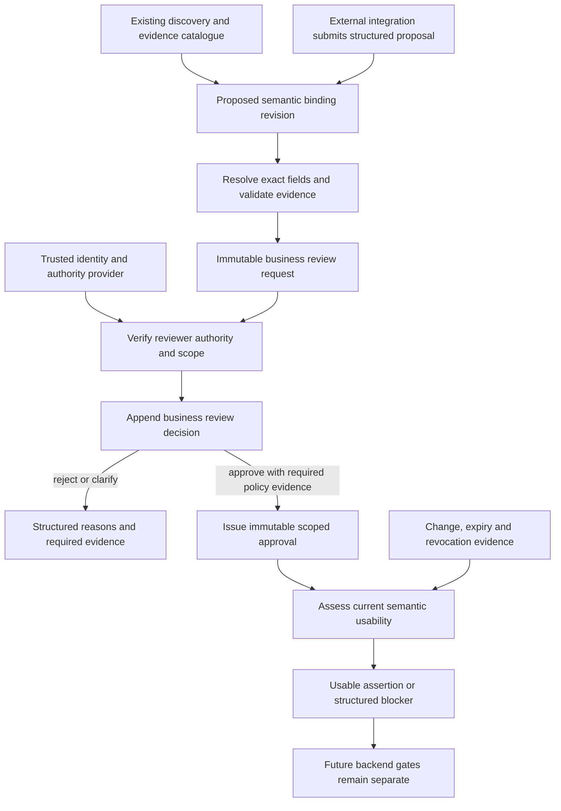
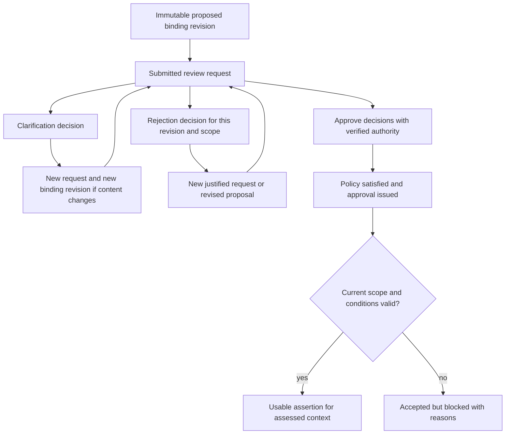
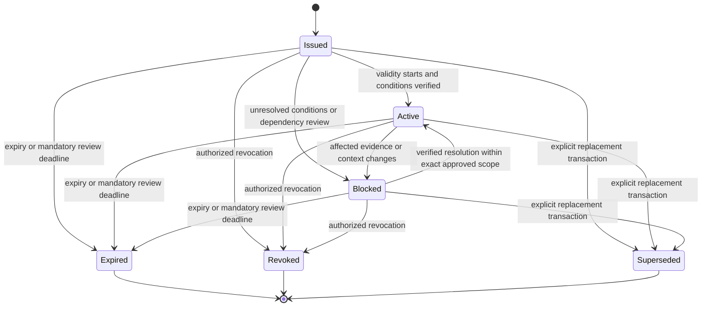

# Trusted semantic bindings and business approval contracts

Design baseline: **2 November 2026**. Status: **proposed design only; no new contract definitions, approval service or runtime behavior are implemented**.

This design extends the [framework architecture](business_prediction_framework_architecture.md) and the [implemented foundation](../development/foundation.md). It specifies how an evidence-supported interpretation of physical data can become an explicitly reviewed, scoped business assertion. It does not establish any actual business meaning or grant permission to prepare data. No predefined questions, scenarios, department-specific routes or column-name-to-meaning rules are introduced.

## 1. Existing foundation: reuse and gaps

| Inspected implementation | Existing reusable capability | Missing capability / design consequence |
| --- | --- | --- |
| [contracts.py](../../src/business_prediction/contracts.py) | `ContractDefinition`, immutable `FieldSpec`, version registration, nested/required/type checks, finite JSON validation, exact references, custom consistency checks and structured errors | Registration and shape/reference validation do not authenticate an approver or evaluate authority. Reuse them for future technical contracts; add trusted decision validation outside the generic validator |
| [metadata.py](../../src/business_prediction/metadata.py) | `DataSourceMetadata@1.0`, `SchemaDiscoveryResult@1.0`, source/schema fingerprints, positioned fields, observations, hypotheses and local evidence IDs | Both contract types require `approval_status=unreviewed`; they cannot be changed to approved. Preserve them and introduce separate semantic/decision records |
| [discovery.py](../../src/business_prediction/discovery.py) | Typed physical profiles, raw headers, distinct-value and temporal hypotheses, coverage/limitations, observed schema comparison | No business concept resolution, source authority, identity namespace, verified date role or approval. A unique value/date syntax is evidence only |
| [catalogue.py](../../src/business_prediction/catalogue.py) | Exact four-part reference resolution, append-only revisions, defensive copies, unordered all-or-none in-process bundle insertion, evidence lookup and exclusive JSON export | No authenticated write boundary, authority checks, concurrency control, trusted clock, revocation journal, signatures or tamper-resistant history. JSON is not an approval credential |
| [foundation guide](../development/foundation.md), [contract tests](../../tests/test_contracts.py), [catalogue tests](../../tests/test_catalogue.py), [discovery tests](../../tests/test_discovery.py) | Documented public interfaces and synthetic preservation/consistency checks | Existing tests verify the foundation, not this proposed governance capability |

Inspection of the existing synthetic fixture confirmed that evidence resolves through a discovery revision plus local evidence ID, hypotheses remain `hypothesized/unreviewed`, and ordinary value changes can change `source_version` while leaving `schema_version` unchanged. No business source was profiled for this design.

Important distinctions in the current code:

- `owner_reference`, `purpose_scope` and an adapter's `SourceConfig` are caller-supplied labels. They are not proof of identity, data ownership or permission.
- The foundation implements envelope identity, owner/purpose, creation time and optional extensions. The broader architecture's evidence/dependency and authorization envelope fields are design requirements, not already universal implemented fields.
- `structural_only=True` deliberately bypasses reference resolution and custom consistency checks. `compare_schemas()` uses that mode for its inputs; its unreviewed change list is not an integrity or business-compatibility certificate.
- The catalogue prevents replacing an existing revision in that catalogue instance; this is not globally monotonic revision allocation or protection against altered/replaced JSON exports.
- A digest proves consistency with bytes or an observed schema representation, not source authenticity, complete capture or authority to approve.

There is no necessary conflict with the proposed architecture. The conflicts to avoid are promoting discovery records to approved, treating a valid JSON record as a trusted decision, assuming positional field IDs are stable business identifiers, or using generic catalogue insertion as an authorization service. All additions below are proposed; existing modules, definitions and tests remain unchanged.

## 2. Design decisions

| Decision | Proposed behavior |
| --- | --- |
| Preserve knowledge layers | Keep physical observations, interpretation hypotheses, owner decisions and approved-use assessments as distinct immutable records |
| Bind exact evidence | Pin source metadata and discovery references, source/schema versions, table/field IDs and position. Names are review aids, never resolution keys |
| Keep meanings extensible | Represent an owner-defined concept/role and definition with scope, grain, units and time/identity qualifications where applicable. No fixed business vocabulary or department list is required |
| Keep proposals immutable | A semantic-binding revision remains a proposal record. Approval is represented by a separate `ApprovalRecord`; effective lifecycle state is a derived, context-specific projection |
| Verify authority externally to labels | Obtain authenticated principal context and versioned authority evidence through a trusted provider interface. Caller assertions and LLM output cannot establish authority |
| Separate acceptance from execution | Semantic approval accepts an interpretation for a scope/purpose. It does not grant source access, approve cleaning/joins, establish a target or authorize training |
| Preserve decision history | Append approval, rejection, clarification, revocation and supersession decisions. Never mutate an old record to change its original meaning |
| Avoid silent scope inheritance | Approval pins an exact binding revision and source/discovery context. New snapshots or changed definitions require a new binding/review/approval path |
| Scope change review | Assess affected dependency paths; preserve unaffected historical approvals. Do not make unrelated departmental decisions universal prerequisites |
| Keep technology neutral | Reuse contract/reference conventions. Specify trusted storage and authorization guarantees without selecting an identity provider, database, LLM, MCP implementation or UI |

An **approved assertion** is the combination of an exact binding revision, a verified approval, its conditions and the context in which it is currently usable. It is not a copied observation with an `approved` flag. Multiple meanings may legitimately apply to one field in different scopes; conflicting meanings in the same requested scope must be surfaced, not resolved by the latest timestamp or largest revision.

## 3. Responsibilities and trust boundary

**All nodes after the existing discovery/catalogue represent proposed behavior.** Any human, rule-based component or external model may propose an interpretation through the same contract. Proposal provenance must disclose its method/version and evidence; no proposal source receives privileged approval status. The backend independently checks references and trusted authority. External presentation and natural-language interaction remain the teammate's responsibility.

Proposed backend responsibilities are contract/evidence validation, scoped review coordination, authority verification, immutable decision issuance, dependency review and current-use assessment. No semantic inference algorithm, approval service, persistence engine or integration adapter is implemented in this task.

## 4. Shared contract and reference conventions

The following are **technology-neutral specifications for future registration**, not executable schemas or currently accepted foundation contract types. Proposed initial contract version is `1.0`; it is not registered by this document.

All eight proposed record types use the existing exact identity: `contract_type`, `contract_version`, `object_id`, positive `object_revision`. Reuse `created_at` with a timezone-aware timestamp, `owner_reference`, `purpose_scope` and optional JSON `extensions`. New records also require `evidence_references` and `dependency_versions`, using empty collections explicitly when applicable. Owner/purpose labels remain descriptive; authenticated identities and scoped authority are separate required fields on decision records.

`ObjectReference` retains exactly the existing four identity fields. An authoritative resolver returns that revision only, never implicit latest. References between different contract versions require explicit compatibility/migration review; numeric revisions across contract-version namespaces cannot be compared as an approval ordering rule. Proposed protected storage allocates revisions and sequences; the current catalogue does not provide that service.

### Physical and evidence references

| Nested specification | Required content and validation |
| --- | --- |
| `PhysicalFieldReference` | Exact `source_metadata_reference` and `discovery_reference`; matching `source_version` and `schema_version`; `table_id`, `field_id`, one-based `field_position`. Resolve the discovery's source reference, table and field; position must agree. An optional cached raw header/display name is non-authoritative |
| Observation evidence reference | `kind=observation`, exact discovery reference and local `evidence_id`. Resolve using existing `get_evidence()`, then verify field/table location, method, denominator, full/sample coverage and relevance to the proposed claim |
| Hypothesis reference | `kind=hypothesis`, exact discovery reference, physical field reference and `hypothesis_id`. It remains inferred evidence and must not be presented as an observation or approval |
| Documentary evidence reference | `kind=documentary`, exact proposed `SupportingEvidenceRecord` reference. Resolve artifact provenance, version/digest, availability, access scope and verification limitations |
| Prior approved assertion reference | `kind=approved_assertion`, exact binding and approval references. Assess their current validity and dependency scope; mere existence of an old approval is insufficient |
| Authority reference | Trusted provider/issuer ID, opaque grant/policy ID and exact version or immutable attestation reference. No provider-specific token format or raw credential is stored in a business record |

Evidence IDs and hypothesis IDs are scoped to their containing discovery revision. Table and field IDs are physical locators within that snapshot/schema, not cross-source business identity. Reuse the existing observation records; do not copy them into a second profiling catalogue. Documentary business evidence needs a separate envelope because the foundation evidence records describe physical field profiles, not authenticated owner documents.

### Purpose, scope, time and conditions

`ReviewScope` is a typed, bounded specification containing purpose, source/discovery/field reference set, business namespace or organizational boundary where relevant, population/record-grain limits, applicable business period and permitted assertion use. Exact identifiers and versioned selectors are data; no hardcoded department names, raw SQL, executable code or unbounded caller-generated predicates are permitted. If selectors are needed, use a separately validated, non-executed declarative representation with an explicitly supported operator vocabulary. Unknown scope is not equivalent to all data.

The initial design grants **semantic interpretation acceptance only**. Cleaning, parsing execution, joins, source access and ML activities require separate future operation authorizations. Approving that a field has a time role does not approve a parser, fiscal calendar, century rule or numeric epoch unless those exact definitions are separately included and supported. Approving an identifier interpretation does not establish a composite primary key, relationship or lifetime uniqueness without evidence for those additional claims.

Differentiate four clocks: business applicability period, human decision time, trusted system recording/commit time and approval-use validity. New approvals cannot retroactively authorize earlier execution. `valid_from` must be at or after trusted issuance; old business periods may still be the subject of a newly authorized interpretation. All comparisons use timezone-aware instants; display timezone never supplies business calendar semantics.

Reuse the foundation's missing/null/unknown/unavailable conventions. Unknown or unavailable authority, exact field identity or required scope blocks approval issuance. Nullable `expires_at`/`review_due_at` is permitted only when policy explicitly allows no fixed deadline, with a recorded reason; omission or unknown does not mean unlimited validity. Qualifiers that do not apply use an explicit not-applicable explanation, not an invented value.

Conditions have an ID, versioned definition, required evidence/attestation, evaluation method and validity/recheck rule. Free-text conditions remain human-review requirements until trusted evidence establishes fulfillment; they never default to true. Future machine evaluation must use approved predicates, not arbitrary generated code. An issued conditional approval may exist while unusable; every required condition must be satisfied before use.

## 5. Proposed contract definitions

The field tables specify requirements beyond the shared envelope. **Required** means present with a valid value; uncertainty is permitted only where explicitly described. All records retain exact dependencies and evidence. The system must reject undeclared/invalid fields using the existing structured-error style.

### 5.1 `SemanticBinding`

Represents one evidence-supported proposed interpretation of a physical field. A binding does not modify the source, discovery, raw header or original hypothesis.

| Field | Type / requirement |
| --- | --- |
| `physical_field_reference` | Required resolved `PhysicalFieldReference` |
| `interpretation` | Required object: owner-defined concept/role identifier or description, explicit business definition, proposed logical meaning, and definition version/reference. No central ontology is mandatory; an external concept reference must be versioned and resolvable |
| `interpretation_scope` | Required `ReviewScope`, including intended grain and namespace where relevant; unknown applicable qualifiers are recorded as blockers |
| `qualifiers` | Required collection of applicable unit/currency, identity scope, temporal role/precision/format or other concept qualifications; each has value/evidence or explicit uncertainty/not-applicable reason. These are proposed definitions, not transformations |
| `supporting_field_references` | Required collection, possibly empty, of exact physical fields relevant to scope or evidence; does not authorize a join or composite-key claim |
| `interpretation_provenance` | Required proposed-by identity claim, proposal method/kind, method/version/configuration reference, creation context and source hypothesis references if any. An authenticated submitter is recorded separately from an unverified claimed author |
| `uncertainties`, `limitations`, `alternatives` | Required explicit collections; no fabricated numeric confidence. Any confidence claim needs a documented measurement method and remains distinct from authority |
| `predecessor_binding_reference` | Nullable exact earlier revision; required for a revision/migration of an existing logical binding. Explain the change and preserve the old record |
| `proposal_state` | Required `proposed` at creation. Do not rewrite it after review; effective lifecycle is projected from decisions and approval-use assessments |

The binding's object ID identifies its logical proposal lineage; changing a field/snapshot, meaning, scope, qualifiers, evidence basis or material provenance creates a new immutable revision. Multiple bindings can reference a field without collapsing alternative meanings. An ordinary numerical field with unique values is not a confirmed business identifier. Date-like syntax or native Excel dates do not establish event/posting/reporting/availability meaning.

### 5.2 `BusinessReviewRequest`

| Field | Type / requirement |
| --- | --- |
| `subject_reference` | Required exact `SemanticBinding` reference for interpretation review, or exact `ApprovalRecord` reference for lifecycle review |
| `requested_review_kind` | Required technical operation: interpretation review or approval-lifecycle review; not a business scenario |
| `requested_scope`, `review_purpose` | Required bounded scope and explicit purpose, consistent with the frozen subject |
| `submitted_by_context_reference` | Required trusted submission context reference; a named requester alone is insufficient |
| `subject_digest`, `evidence_snapshot_references` | Required frozen subject digest and complete reviewed evidence basis; reviewers cannot approve content that changed after submission |
| `review_policy_reference` | Required exact policy defining eligible authority, necessary evidence, conditions and number/independence of reviewers |
| `predecessor_request_reference` | Nullable exact earlier request for clarification/resubmission/appeal; reason required when present |
| `expected_governance_head` | Required protected-store sequence/revision for stale-write checks; not the greatest caller-supplied object revision |
| `due_at` | Optional timezone-aware review deadline; absence is not an approval or a default decision |

A review request cannot appoint its own authorized owner. The trusted policy resolver determines the responsible authority for the object, purpose and scope. Required review roles are policy-driven, not a fixed list of departments. Clarification or rejection does not modify the submitted binding.

### 5.3 `AuthorityVerificationRecord`

| Field | Type / requirement |
| --- | --- |
| `principal_reference`, `authentication_context_reference` | Required trusted identity and authenticated session/attestation reference; no raw credential/token |
| `authority_reference`, `policy_reference` | Required slots for trusted grant/issuer and governing policy versions. A missing grant may be explicitly unknown/null with a reason only for denied/unavailable outcomes; verified outcomes require an exact resolved grant |
| `requested_action`, `subject_reference`, `scope` | Required exact action/object/purpose/scope whose authority was checked |
| `verified_by`, `verified_at`, `verification_valid_until` | Required trusted verifier identity/time; a verified outcome requires a freshness limit. Failed checks may record a null limit with a reason; records are server-issued, not accepted as caller assertions |
| `grant_validity`, `delegation_chain` | Required validity evidence and delegation/issuer provenance; explicit empty chain when direct authority applies |
| `verification_outcome`, `reason_codes` | Required verified/denied/unavailable result and traceable reasons. Only verified matching authority can support a decision |
| `verification_receipt_reference` | Required tamper-evident protected receipt/digest reference covering the checked context; mechanism selected before implementation |

This record is an attestation from the future trusted authorization boundary. Recording JSON that looks like this does not establish authority. Authority for approve, reject, request clarification, revoke and supersede must be checked independently for the relevant scope; a proposer or original approver is not automatically allowed every action.

Verification freshness governs when the reviewed action can be accepted. Expiry of an archived verification receipt does not by itself erase an approval legitimately issued while that authority was valid. Current use separately checks approval validity, receipt integrity, explicit withdrawal and any policy-required continuing authority. A missing current trust state still blocks affected use; an unverified claimed principal never becomes an authenticated reviewer.

### 5.4 `BusinessReviewDecision`

| Field | Type / requirement |
| --- | --- |
| `review_request_reference`, `subject_reference`, `subject_digest` | Required exact frozen request/subject/digest; all must agree |
| `action` | Required approve, reject, request_clarification, revoke or supersede |
| `reviewer_principal_reference`, `authority_verification_reference` | Required authenticated reviewer and verified, action-matching authority record |
| `decision_scope`, `review_policy_reference` | Required purpose/scope/policy, no broader than request, subject and verified authority |
| `decided_at`, `recorded_at` | Required trusted decision/commit timestamps. External claimed timestamps are separate evidence and cannot backdate authorization |
| `rationale`, `conditions`, `limitations` | Required explicit rationale and collections; include unresolved evidence/questions for clarification or rejection |
| `affected_approval_reference` | Required for revoke/supersede; absent for an ordinary interpretation decision |
| `replacement_approval_reference` | Required for supersede; must identify an independently valid issued replacement approval |
| `expected_governance_head`, `command_id`, `record_receipt_reference` | Required ordering, idempotency and trusted record provenance |

Approve/reject/request_clarification decisions concern the exact binding review. Revoke/supersede decisions concern an existing approval, not a rewrite of a proposal. An approve decision is an owner's review result; approval issuance still requires all applicable policy checks/quorum. A decision record alone cannot bypass those checks.

### 5.5 `ApprovalRecord`

| Field | Type / requirement |
| --- | --- |
| `approved_object_reference`, `approved_object_digest` | Required exact `SemanticBinding` revision and reviewed content digest; no floating revision or wildcard future snapshots |
| `review_request_reference`, `approval_decision_references` | Required request and one or more verified approve decisions satisfying the versioned review policy |
| `approver_principal_references`, `authority_verification_references` | Required traceable approving principals and exact matching authority evidence; identities agree with decisions |
| `approval_purpose`, `approval_scope` | Required bounded semantic-acceptance purpose/scope; may narrow the reviewed request, never expand it |
| `policy_reference`, `conditions`, `limitations` | Required policy and explicit conditions/limits. Record any continuing-authority, evidence freshness or independent-review requirements |
| `issued_by`, `issued_at`, `valid_from` | Required trusted issuer and issuance/use-validity times; not submitted owner labels |
| `expires_at`, `review_due_at`, `no_deadline_reasons` | Deadline fields explicitly nullable under policy; the reasons object must contain a policy-supported explanation keyed by each absent fixed bound |
| `record_state`, `record_receipt_reference` | Required immutable `issued` and trusted ledger receipt. Active/revoked/expired are derived states, not mutable flags |

One record covers one exact approved object revision and a bounded, indivisible scope. Initial policy revokes/supersedes whole approval records. A partial scope change requires explicitly issuing a narrower replacement record and retiring the old record atomically, rather than editing its scope. This avoids ambiguous scope subtraction and hidden residual authority. Multiple approvals for different scopes remain individually traceable; each additional approval needs its own explicit review/issuance path.

### 5.6 `SupportingEvidenceRecord`

| Field | Type / requirement |
| --- | --- |
| `artifact_reference`, `artifact_version`, `content_digest`, `digest_scheme` | Required immutable documentary evidence location/version and digest with a versioned encoding scheme; no arbitrary external URL is treated as trusted |
| `evidence_kind`, `claim_summary`, `relevant_subject_references` | Required provenance/claim description and exact relevant bindings/fields/sources; not an assertion that the claim is correct |
| `origin_identity_reference`, `received_by`, `received_at` | Required origin slot and trusted ingestion provenance, distinguishing verified identity from a claim. Unknown origin must be explicitly marked, limited and assessed under evidence policy; never invent an origin |
| `origin_verification`, `limitations`, `coverage` | Required verified-origin/unverified/unavailable status, checks/limitations and applicable population/period; verified origin is not business approval |
| `access_policy_reference`, `retention_reference` | Required authorized evidence access and retention controls; raw secrets or personal data are not copied into routine logs |
| `valid_until`, `predecessor_evidence_reference` | Explicitly nullable validity/predecessor where applicable; exact new revision for a changed artifact |

Evidence withdrawal, compromise or retraction is a trusted dependency-state event referencing the original record, not deletion or editing of its original provenance. Its effect is captured in a change/use assessment. Selecting the authoritative source of these events is an open implementation decision.

### 5.7 `BindingChangeAssessment`

| Field | Type / requirement |
| --- | --- |
| `binding_reference`, `approval_references` | Required exact affected binding and known approvals, with explicit dependency coverage |
| `previous_context_references`, `new_context_references` | Required exact old/new source, discovery, schema, evidence, concept/policy or authority contexts |
| `trigger_kind`, `trigger_reference`, `detected_at` | Required source/schema/position/reader/meaning/evidence/policy/authority/validity change and provenance/time |
| `observed_changes`, `comparison_method_reference` | Required change facts, profiling-scope limits and comparison version. Fully validate inputs before consuming the existing structural comparison result |
| `dependency_paths`, `impact`, `required_actions` | Required affected paths and supported outcome: no effect within original scope, review required, or incompatible with proposed current use; questions/actions remain explicit |
| `assessed_by`, `assessment_method`, `limitations` | Required trusted human/system assessor and reproducible method; an automated comparison is not an approval |

This is an impact report, not a supersession or renewal authorization. The original approval remains historical evidence for its original context even when unusable for a new snapshot. Downstream semantic assertions referencing that approval become affected dependencies; future plans/artifacts must participate when those components exist.

### 5.8 `BindingUseAssessment`

| Field | Type / requirement |
| --- | --- |
| `binding_reference`, `candidate_approval_references` | Required exact proposal and considered approvals; absence is explicit, never guessed by matching names |
| `requested_context`, `assessed_at` | Required caller/purpose/scope, exact current source/discovery/field context and assessment instant |
| `trusted_governance_head`, `authority_context_reference` | Required current ledger/policy/revocation watermark and access/authority check context |
| `resolved_dependencies`, `condition_results`, `change_assessment_references` | Required exact dependency versions and verified condition outcomes, including unresolved states |
| `result`, `reason_codes`, `required_evidence_or_action` | Required usable/not_approved/rejected/conditions_unverified/needs_review/expired/revoked/superseded/conflict/access_denied/authority_unavailable/invalid_reference result and precise reasons |
| `valid_until`, `recheck_triggers`, `assessment_receipt_reference` | Required freshness bound/triggers/receipt for the assessed context; not a portable execution permission |

A usable assessment certifies only scoped semantic applicability as of a trusted watermark. It grants no access, cleaning or execution authority. Future consumers must recheck relevant state at use/commit time; a stale exported assessment cannot override revocation or a changed source.

## 6. Review, approval and revocation lifecycle

### Immutable review records and projected state

Arrows represent new records or derived state, not mutation of the preceding record. Each decision closes the particular request/disposition it addresses. Clarification responses create new documentary evidence and a new request; if evidence basis, interpretation or scope changes, create a new binding revision. Rejection for one exact purpose/scope does not silently prohibit another legitimate use, nor does a resubmission erase the rejection. Appeals need a policy-authorized new request referencing the earlier decision.

The status projection key includes exact binding, requested scope/purpose, assessment time and governance watermark. There is no universal `binding.approved=true`. Request/approval states and timestamps must be reconstructible from the append-only journal. Proposals and discovery hypotheses remain as originally recorded.

### Approval-use lifecycle

These are projected **use states**, not changes to the stored `record_state=issued`. Unblocking is permitted only when an already approved condition is verified within the exact original definition/scope. Changing a condition, object, evidence basis or validity interval requires new review and approval. Expired, revoked or superseded approvals do not reactivate; a new approval record is required. Revoking a replacement never silently restores the old superseded record. Later security findings may be appended to terminal records without making them active.

Proposed initial processing rules:

1. Freeze and validate proposal/evidence, then submit a request against a known governance head.
2. Verify the reviewer through trusted identity/authority evidence at decision time, including scope, action, delegation, freshness and independence/quorum policy. Record denied/unavailable verification without issuing approval.
3. Record the action, exact reviewed digest, rationale, conditions and trusted commit time. Approval decisions are necessary but not alone sufficient for issuance.
4. Issue the approval and its audit/authority evidence atomically only when policy is satisfied. The initial implementation must reject stale concurrent writes; a replayed command ID returns the same committed outcome and cannot produce a different decision.
5. At use, resolve the exact object, approvals, conditions, field context, ledger state and relevant change assessments. Any unknown mandatory state blocks use with a precise reason.
6. A revoke action requires current revocation authority and the exact approval reference. It makes that approval unusable when committed; preserve original issuance and identify affected dependents. Do not retroactively rewrite evidence of prior permitted use.
7. Supersession requires a separately valid replacement binding/approval and explicit authorized retirement of the old approval. Commit replacement availability, supersession and audit state as one protected transaction. Approval of a new revision alone does not silently supersede an old approval.

For planned or concurrent supersession, the replacement must be usable for the intended context and retirement effective time; otherwise block the transaction or explicitly record withdrawal without claiming replacement coverage. A narrower replacement never covers an excluded part of the old scope. Competing incompatible assertions for the same requested scope return `conflict`; there is no latest-wins rule.

## 7. Validation rules and trusted acceptance

Future implementation should reuse generic structural validation and add domain-neutral governance invariants and trusted checks. **Structural validation is necessary but not sufficient.** A proposed record cannot establish its own trust by passing `ContractRegistry.validate()` or appearing in `MetadataCatalogue`.

| Rule | Required validation / non-success behavior |
| --- | --- |
| Exact object identity | Resolve four-part references and content digests; reject missing, mismatched or floating versions |
| Physical correspondence | Fully validate source/discovery records; source version, schema digest, table, field and position agree. Do not resolve by label similarity |
| Relevant evidence | Evidence exists in its exact version, applies to the claim and records completeness/sampling/limitations. Hypotheses are never relabeled observations |
| Meaning clarity | Explicit concept definition and applicable qualifiers. Technical uniqueness cannot prove a business ID; date syntax cannot prove a business time role |
| Scope containment | Decision/approval scope fits the request, subject, purpose, authority and policy. If containment cannot be established, return clarification or denial, not a broader interpretation |
| Verified identity | Principal originates from trusted authenticated context; reject a body-supplied owner, role or `approved` flag as proof |
| Verified authority | Trusted grant/policy and delegation valid for action, exact context and decision time; unavailable verification blocks approval |
| Policy and independence | Required reviewers/quorum and any proposer-reviewer separation satisfied. Never manufacture approval from an incomplete set of decisions |
| Frozen content | Subject/evidence digest and request match the exact reviewed content; require a new review when content changes |
| Valid time | Trusted issuance/commit times, valid half-open use interval and mandatory review requirements; unknown bounds/clock anomalies block use |
| Conditions | Every applicable required condition has current trusted fulfillment evidence; human text or an LLM assertion is not a verified condition |
| Revocation/supersession | Exact approval subject, authorized action, protected ordering and valid replacement where claimed; no implicit revival |
| Dependency safety | Affected field/schema/reader/evidence/policy changes assessed; reject cycles among dependent approved assertions and report unavailable dependency state |
| Immutable history | No replacing prior revisions, editing a scope/decision or removing an inconvenient rejection. Administrative corrections append explicit successor records |
| Replay/concurrency | Trusted command IDs, expected-head comparison and atomic commits prevent conflicting lifecycle decisions; catalogue in-process atomicity alone is insufficient |
| Consumption freshness | Recheck relevant current source/authority/revocation state before a future dependent operation commits. Cached/exported approval status cannot override new restrictions |

Future validation errors should reuse `ValidationIssue(path, code, message)` and safe `FrameworkError` envelopes. Proposed governance codes include `unresolved_evidence`, `field_context_mismatch`, `unverified_principal`, `authority_denied`, `authority_unavailable`, `scope_mismatch`, `review_required`, `condition_unverified`, `stale_governance_head`, `approval_expired`, `approval_revoked`, `approval_superseded` and `conflicting_assertions`. These are technical dispositions, not answers mapped to business questions. Return only necessary authorized clarification/evidence requirements.

## 8. Source, schema, evidence and dependency changes

Maintain a proposed dependency graph linking exact source/discovery/field and evidence versions to binding revisions, review requests, approval records and dependent approved assertions. Future preparation plans/artifacts can join this graph when implemented; none are created now. Impact propagation changes current usability projections or triggers review; it does not mutate historical nodes.

| Change | Required prospective behavior | Historical behavior |
| --- | --- | --- |
| Source fingerprint changes, observed schema stays equal | New snapshot is outside the exact approval. Create a new context/binding revision and impact review; unchanged relevant fields may simplify evidence review, never authorize inheritance | Old approval remains bound to the original snapshot |
| Same bytes, new reader/settings/header interpretation or discovery revision | Reassess interpretation/evidence and exact references even if schema digest matches; a digest omits some reader/profiling context | Keep both interpretations and their provenance |
| Field added/removed, header changed or table/field reordered | Report positional identity ambiguity, validate relevant old/new contexts and block automatic rebinding. Removal is incompatible with use that requires the field | Do not rename/repoint the old binding |
| Different observed type set or sampling/coverage policy | Distinguish observed evidence drift from declared schema change. Full validation and scope-aware review are required; sample absence is not proof of a type disappearing | Preserve the prior population/coverage and hypotheses |
| New unrelated field/table | Record changed context; assess actual dependency paths. Do not revoke all prior historical assertions. New-snapshot use still needs exact renewed binding/approval | Unrelated original-context uses remain assessable |
| Definition, namespace, unit, format, grain or purpose changes | New semantic revision and explicit approval. Do not convert meanings or widen scope in place | Previous interpretation remains traceable and cannot authorize the new meaning |
| Evidence revision, withdrawal, expiry or compromised origin | New evidence/state event and impact assessment; block dependent use while required support is missing or invalid | Retain original evidence and when the issue became known |
| Policy/authority changes | Apply versioned policy and explicit trust/revocation rules. Review affected permissions; do not let stale authority receipts authorize new decisions | Legitimate earlier decisions are not erased merely because an owner later changes role |
| Approval expiry/review deadline, revocation or supersession | Stop affected use and propagate review/blockers to dependents; require a new approval to renew or replace | Retain original issuance, decision/effective times and downstream-use audit |

The initial default is **exact-snapshot approval**, not a standing grant for future data with the same schema hash. Any future standing approval would need its own explicitly approved compatibility policy, bounds and revalidation evidence; it is not introduced here. Source identity and field meaning cannot be inferred solely from matching names or a change list.

Use validity is assessed over `[valid_from, earliest_applicable_deadline)`, additionally bounded by revocation/supersession and unmet conditions. Mandatory review due dates block further use until a new accepted review/approval exists; advisory reminders, if needed later, must be explicitly distinguished by policy. Historical views support both the business applicability period and what the system had recorded by a given audit time. A later-discovered error flags prior affected uses for owner review; it cannot falsify the historical audit or authorize past work retroactively.

Continuing authority is a policy question: an approver valid at issuance need not hold the same job forever, but a compromised grant or explicit organizational withdrawal can require invalidation. Record the governing rule rather than automatically deleting past approvals or ignoring authority changes. If the required current policy or revocation state is unavailable, block the affected current use.

## 9. Integration interfaces and security

Proposed logical operations are submit binding, validate binding, request review, verify authority, record decision, issue approval, assess change, assess semantic use and retrieve exact history. Their inputs/outputs are the contracts above and structured errors, not natural-language commands. They are **not implemented API routes, MCP tools or UI actions**. An external integration may wrap them without changing business/authority rules or depending on an LLM provider.

| External integration responsibility | Backend/trusted-boundary responsibility |
| --- | --- |
| Supply a structured proposal, evidence references and requested purpose | Validate references, evidence provenance, scope and uncertainties independently |
| Obtain human responses through the organization's review process | Authenticate the actor and verify action-specific authority through the trusted provider |
| Present clarification, rejection and current-use results | Return structured minimal blockers and exact review/version history |
| Forward a requested approval/revocation action | Verify trusted context and expected ledger head; never accept the request itself as an authorized decision |

The future approval writer must be a protected path. Existing generic catalogue import/add functions and editable JSON cannot be the sole source of authority; imported records require verified provenance/receipts before they influence use. Contract registration is a trusted backend configuration action, not a capability granted to external callers to define their own approval rules. Metadata `extensions` remain inert and cannot override policies or statuses.

Require least-privilege evidence and decision access, scoped authority/delegation, appropriate independent review and purpose isolation. Evidence links resolve through authorized providers; an uploaded document, matching hash, familiar display name or asserted email is not verified authority. Store credential references, not secrets. Restrict disclosure of source/field names and business evidence to authorized reviewers; routine logs contain record references and safe reason codes rather than raw values or tokens.

Trusted records need an accountable issuer, authoritative ordering/time, immutable history, protected persistence and tamper-evident receipts. The exact digest canonicalization/receipt scheme, signing or storage controls must be versioned and selected before implementation; no cryptographic assurance is claimed for current JSON. No particular identity provider, distributed ledger, database or new infrastructure is mandated.

A future dependent operation must check caller authorization separately from semantic validity, then guard against changes between assessment and commit using a consistent governance watermark/transaction or equivalent recheck. A usable `BindingUseAssessment` is not a bearer permission and cannot be replayed against another dataset, purpose or time. Monitoring may propose review, but cannot approve a meaning, issue a grant or silently renew an expired decision.

## 10. Unresolved implementation decisions

| Decision | Required owner / evidence |
| --- | --- |
| Trusted principal and authority sources | Backend, security and business/data owners must identify authoritative identities, ownership grants, delegation and action-specific revocation authority |
| Policy stewardship and reviewer independence | Assign policy owners, applicable quorum/independence, appeal handling and emergency withdrawal rules without a fixed department list |
| Scope and concept governance | Agree versioned scope-selector semantics, namespace/grain/unit qualifications and optional concept-document references; unresolved scope must remain blocked |
| Decision persistence and concurrency | Select protected append-only persistence, atomic ordering, command idempotency, availability and recovery requirements. Current development JSON is insufficient for trusted concurrent approvals |
| Time, expiry and review policy | Agree trusted clocks/skew, maximum receipt age, mandatory review periods and policy-allowed no-deadline cases |
| Documentary evidence verification | Identify accepted provenance/attestation providers, content-digest canonicalization, withdrawal/retraction events and review of conflicting evidence |
| Authority change effects | Decide which approvals need continuing authority and how compromised or withdrawn grants affect previously issued decisions |
| Compatibility and migration | Define future contract migration and reapproval procedures. No automatic new-snapshot inheritance or cross-version semantic equivalence is assumed |
| Audit/privacy/retention | Determine access, retention, lawful redaction/deletion and audit-preservation requirements; immutable history is not permission to retain sensitive data indefinitely |
| Integration ownership | Agree structured authentication context, error envelopes and delivery of clarification/review requests with the teammate; no UI/LLM/MCP dependency belongs in core semantics |

No actual approver, business rule, scope or deadline is confirmed by this document. Resolving implementation policy does not itself resolve NOP's business definitions; the [business rule register](../../reports/analysis/business_rule_register.xlsx) and [clarification/readiness documents](../../reports/analysis/initial_prediction_business_clarification.md) remain unchanged evidence and owner-review inputs.

## 11. Design validation and next boundary

Design checks cover the eight proposed contracts, three lifecycle diagrams, exact reference/dependency paths, distinction between observations and assertions, all five required review actions, revocation/no-revival behavior, scope/time/authority validation and unchanged foundation compatibility. Mermaid diagrams are supplied as Markdown diagram source; no new renderer or application dependency is required. They describe future lifecycle behavior, not implemented services.

The requested output path was checked and did not exist. Preservation checks compare the pre-task baseline of **221 existing files**, allowing only the README link addition. Existing Python modules, contracts, all five test files, earlier documents, 167 report/evidence files, four notebooks and all 17 original sources are protected by hash comparison. Source bytes are read only for preservation hashes. No business data is cleaned, transformed, joined or used for feature/target/model work. None of the proposed contract types is registered or implemented, no existing metadata status is changed and no approval is issued.

Validation results: all **35 relative links** across this document and README resolve; eight proposed contract sections, three Mermaid diagram blocks, balanced code fences and consistent Markdown table shapes were checked. Diagrams were reviewed as source; no new renderer was installed. All **220 existing files other than README** match the pre-task hashes, and README's original content is preserved before its appended design section. Source hashes also match the existing validated 17-file integrity manifest.

The existing **38 synthetic foundation tests passed unchanged**, with warnings treated as errors, using `.venv/Scripts/python.exe -B -W error -m unittest discover -s tests -t . -q` with `PYTHONPATH=src`. This is a regression check; it does not validate proposed approval behavior. Future implementation must add tests for forged owner labels, missing/wrong exact references, sampled uniqueness, ambiguous time roles, stale authority, scope expansion, unresolved conditions, concurrent/replayed commands, expiry, revocation, explicit supersession, no implicit revival, reordered fields, unchanged-schema/new-source snapshots, evidence withdrawal, dependency cycles and provider-independent structured integration. These are test requirements only; no tests or implementation are added in this design task.

Next activity requires explicit approval to implement the agreed contract definitions and trusted authority/review boundary. Source preparation, business transformations, model development and external integration remain separately authorized activities.
