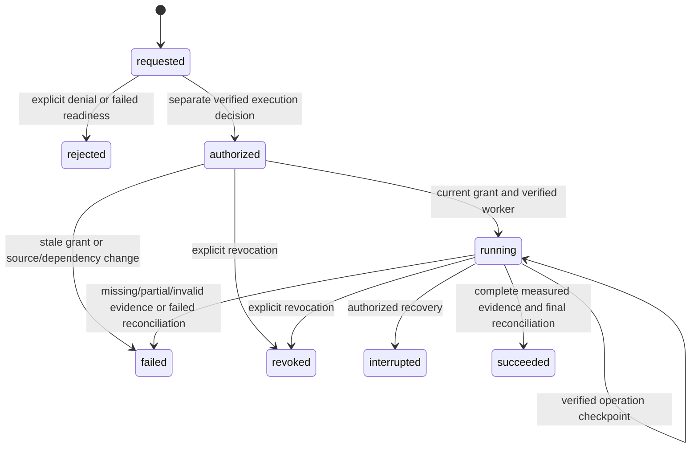

# Controlled preparation execution and provenance

Implemented baseline: **3 November 2026**. References: [framework architecture](../architecture/business_prediction_framework_architecture.md), [semantic approvals](semantic_approval_foundation.md), [durable runtime](durable_runtime.md), [requirement assessment](prediction_requirement_assessment.md) and [target/observation/preparation specifications](target_observation_preparation_specifications.md). Earlier documents are preserved as historical baselines.

This addition implements execution **control and evidence registration**, not preparation operators. No NOP data is cleaned, transformed, joined, aggregated or used to create training datasets. There is no transformation dispatcher, model training, inference, LLM, MCP or UI. Automated tests use an isolated synthetic identity worker and temporary measured artifacts only.

## Components and contracts

```text
src/business_prediction/execution/
    __init__.py
    contracts.py
    interfaces.py
    reconciliation.py
    service.py
tests/
    execution_support.py
    test_controlled_preparation_execution.py
docs/development/controlled_preparation_execution.md
```

| Component | Implemented responsibility |
| --- | --- |
| [Contracts](../../src/business_prediction/execution/contracts.py) | Eight additive version `1.0` execution/provenance types; exact references, nested artifact metrics and lifecycle invariants |
| [Interfaces](../../src/business_prediction/execution/interfaces.py) | Trusted source verification and worker/artifact evidence boundaries; explicit read-only local adapter verifier |
| [Reconciliation](../../src/business_prediction/execution/reconciliation.py) | Extensible measured reconciliation and conservative native-row preservation checks |
| [Service](../../src/business_prediction/execution/service.py) | Explicit authorization, bounded/fenced lifecycle, operation checkpoints, terminal validation, failure/recovery and immutable provenance |

| Contract | Recorded evidence |
| --- | --- |
| `PreparationExecutionRequest` | Durable request key, exact plan/digest, source/discovery/schema/field manifest, requested worker principal, bounded lease and purpose |
| `PreparationExecutionDecision` | Explicit approved/denied/revoked action, verified exact-action/object/scope authority receipt, authenticated authorizer, rationale, reasons and timestamp |
| `PreparationExecutionAuthorization` | Separate positive operational grant; exact request/plan/source versions, pinned current business approvals, worker principal, expiry and verification/validator/reconciliation provider versions |
| `PreparationExecutionState` | Immutable sequential states, previous revision, authorization, lease/fence, timestamps, checkpoint receipts, input/output artifact references, failure information and final reconciliation |
| `PreparationArtifact` | Execution-scoped immutable descriptor: locator, SHA-256 digest, byte size, measured rows/duplicates/missingness/schema, source lineage, role, completeness and evidence reference |
| `PreparationOperationReceipt` | Exact operation digest/version, request/authorization, worker evidence reference, input/output artifacts, completion/times, nullable accepted/rejected counts and reconciliation |
| `PreparationReconciliationResult` | Per-operation or final checks, passed/failed/unavailable results, method/version, failure codes and assessment time |
| `PreparationProvenanceRecord` | Immutable terminal manifest joining source versions, plan, authorization, full operation specifications, receipts/artifacts, reconciliations, timestamps, outcome and failure information |

The new types reuse the existing versioned registry, scope, exact references, errors, catalogue and journal. Existing semantic and preparation approval contracts remain unchanged. They retain `execution_authorized=false`: a valid/approved plan is never itself an execution grant.

## Authorization and lifecycle



Terminal states cannot be reopened or changed to successful. A new attempt requires a new request key and new authorization. Historical records and rejected/failed manifests are preserved.

Authorization independently checks the currently approved plan and its target/observation/relationship/semantic dependencies through the existing validator. It pins exact currently usable approvals rather than copying their apparent status. Live source verification, supported reconciliation and healthy evidence integrations are mandatory. A later revoked, expired, superseded, conditional or stale pinned approval blocks execution even if another approval is subsequently created. Source/schema changes do not inherit permission.

The default policy separates requester and execution authorizer. The operational authorizer must have a verified `authorize_preparation_execution` grant for the exact request and scope. Business-review quorum remains enforced by existing specification approvals; this operational decision is separate. External authorization policy must establish who may grant execution for all operations, datasets, budgets and purposes in the request.

The requested worker principal is an authorization constraint, not an authenticated caller label. Every worker action verifies actual identity/action/scope and matches that principal. Authorization receipts must remain verifiable, and continuing operational authority is required. Authorization expiry is bounded by its explicit expiry, authority receipt and pinned business-approval deadlines. The prototype lease is 1–3600 seconds and cannot exceed the authorization expiry.

`begin()` consumes an authorized state once and records a fresh fence token. Source versions, approvals, providers and lease validity are rechecked at checkpoints and finalization. Verification completion refreshes the control clock, authorization and lease checks, so slow source/artifact I/O cannot silently retain an expired grant. Measurements made after command entry are evaluated against the refreshed time rather than incorrectly treated as future evidence. The authenticated principal must remain the same throughout the command.

A metadata checkpoint never dispatches an operator. Future external workers must honor the lease/fence and isolated staging requirements before writing; this package does not sandbox arbitrary Python or control unrelated filesystem processes.

## Public interfaces

Construct through `runtime.controlled_preparation_service(sources=..., evidence=..., operations=None, reconciliation=None)`.

| Method | Result / boundary |
| --- | --- |
| `request(plan_ref, request_key=..., worker_principal_reference=..., lease_seconds=..., purpose=..., context=..., command_id=..., expected_head=...)` | Pinned request and initial requested state; no authorization or data execution |
| `authorize(request_ref, approve=..., expires_at=..., rationale=..., context=..., command_id=..., expected_head=...)` | Explicit decision and optional grant; readiness failure creates a durable rejection with reasons |
| `begin(request_ref, context=..., command_id=..., expected_head=...)` | Authorized, fenced running state, or failed terminal state when dependencies are stale |
| `record_operation(request_ref, operation_id=..., evidence_handle=..., context=..., command_id=..., expected_head=...)` | Verify the next approved operation's external evidence; register immutable receipts/artifacts/reconciliation; never execute its parameters |
| `finalize(request_ref, context=..., command_id=..., expected_head=...)` | Final completeness/integrity checks and atomic terminal state/provenance manifest |
| `interrupt(request_ref, reason=..., context=..., command_id=..., expected_head=...)` | Explicit interrupted state and preserved known evidence; no automatic resume |
| `revoke(authorization_ref, rationale=..., context=..., command_id=..., expected_head=...)` | Explicit immutable retirement and revoked state |
| `state(request_ref)` / `get(ref)` | Trusted-backend latest-state / exact historical reads; external integrations require read ACLs |

Required action grants are `request_preparation_execution`, `authorize_preparation_execution`, `begin_preparation_execution`, `record_preparation_operation`, `finalize_preparation_execution`, `recover_preparation_execution` and `revoke_preparation_execution`. Caller-provided names and success flags do not bypass them. Unauthorized actions fail closed and use existing durable failure/authority audit mechanisms.

## Evidence and reconciliation boundaries

`SourceVersionVerifier` must verify exact live/immutable snapshots, not accept a caller's current flag. The included `AdapterSourceVersionVerifier` reuses explicitly supplied read-only adapters and discovery, comparing source fingerprints, schema versions, layout/settings and consistency metadata. It publishes no new discovery and writes no source values. It is development-only: repeated file hashes are not production immutable-snapshot isolation or a filesystem lock.

`ExecutionEvidenceVerifier` has no permissive implementation. An approved integration must independently verify worker receipts/fences, exact operation/version, source-to-input lineage, staging ownership, original-source isolation, sealed artifacts and measured content/statistics. It provides observed operation evidence and remeasures artifacts. A caller's evidence handle is only a locator for verified external evidence, never proof by itself. Missing providers, unknown evidence handles, malformed evidence and unavailable measurements cannot produce success.

The included synthetic verifier exists only in tests. It writes immutable temporary identity-copy fixtures, computes byte hashes, row/duplicate/null/type statistics from those files, and supports injected faults. It is not an implementation of a business preparation operation and is rejected as a production integration.

`ReconciliationStrategy` is an extensible trusted validation interface. The default `RowPreservationReconciliation` supports only explicitly bounded operations that preserve native rows/grain. It checks measured input partitions, accepted/rejected output counts, no undeclared filtering, schema preservation and duplicate/missingness statistics where pure inspection must preserve them. Missing counts remain null/unavailable, never fabricated zeroes.

Filtering, joins, aggregation, schema changes, derived targets, quantity conservation and financial reconciliations require approved target/operation-specific reconciliation strategies and evidence. They are not silently checked with row equality. Unknown or ambiguous strategies block authorization. Registering a reconciler does not implement or authorize a transformation; the earlier target/observation/plan restrictions still apply.

For initial inputs, the controller checks authorized physical fields, exact table population and observed schema. Later inputs must match preceding accepted artifacts' digests. Outputs must preserve contributing source lineage, use separate locators and have complete measured descriptors. A production evidence provider remains responsible for proving data lineage and preventing source aliases/path escapes; metadata comparisons alone cannot establish the origin of arbitrary bytes.

Finalization requires every operation receipt, passed operation reconciliation, current approvals/authorization/sources/lease, and reverified input/output artifact integrity. No receipt, partial output, unavailable statistic, failed reconciliation or provider failure is treated as completed execution. A success manifest is an eligibility boundary only; no files are promoted, published or exposed to training by this service. Historical success is not an ongoing data-use permission: future consumers must recheck approval validity and artifact integrity before using an output.

## Durability and failure handling

- Request keys deduplicate an exact intent within purpose/namespace. Identical requests return the same request; changed intent under the same key is rejected. Terminal work is never automatically retried.
- Command IDs use the existing authenticated payload-bound replay and expected-head protections. Replaying returns the original historical response; integrations must read current state before further action. A replay is not a renewed lease or grant.
- State, artifact descriptors, receipts, reconciliation, provenance, journal entries and audit commit in the same metadata transaction. Generic catalogue imports cannot create trusted execution history.
- A failed metadata write rolls back metadata. External files cannot be rolled back by a metadata database and remain untrusted staging. Recovery must reconcile an uncertain commit by replaying the same command ID before creating another attempt.
- A stopped process leaves its last durable state. Restart does not infer completion from files or automatically resume. An authorized operator can record interruption and preserve known artifacts. Expired leases block further progress.
- Partial/failed artifacts remain quarantined in provenance; original sources are never overwritten or removed. `no_registered_output` means no verified output descriptor was committed, not proof that an external worker created no orphan files.
- External orphan enumeration, cleanup/retention, durable staging/promotion and fencing enforcement need a real artifact/worker integration. No unsafe deletion or cleanup command is supplied here.

The runtime's SQLite/full-state transaction design, clock floor and consistency checks remain unchanged. It is suitable for bounded local operation; it is not a high-throughput production executor or an atomic transaction across databases and filesystems. Snapshot isolation, storage immutability and publication protocols require approved production integrations.

## Integration and production requirements

Only the [runtime factory](../../src/business_prediction/runtime/factory.py), [durable coordinator](../../src/business_prediction/persistence/coordinator.py), [semantic command allowlist](../../src/business_prediction/semantics/service.py) and [README](../../README.md) are extended. Registration occurs before recovery; new execution records join protected journal-issued types. Existing contract definitions, preparation/specification services, tests, reports and notebooks remain unchanged. There is no dependency addition or project database creation.

Development and production-oriented interfaces share the same control logic. Production rejects development/unapproved source/evidence adapters, local storage/security defaults and missing enterprise integrations. Missing evidence providers cannot create an execution grant. Real production storage, identity, authorization/policy, evidence-origin, immutable snapshots, worker/artifact verification and safe publication remain external requirements. No production service is connected by this task.

Trusted adapter and reconciliation registration is an application boundary; remote callers cannot supply Python classes/import paths. Do not expose raw runtime/catalogue objects as public APIs. Secrets stay in existing provider/secret interfaces, never in execution contracts or artifact payload logs.

## Validation and next milestone

```powershell
$env:PYTHONPATH = Join-Path (Get-Location) 'src'
.\.venv\Scripts\python.exe -B -W error -m unittest discover -s tests -t . -q
```

The [synthetic fixture](../../tests/execution_support.py) and [tests](../../tests/test_controlled_preparation_execution.py) cover authorization and worker failures, explicit denial, duplicate/replayed requests, approval revocation, changed sources, expiry, partial/unperformed outputs, missing statistics, failed reconciliation, artifact tampering, fencing, interrupted/restarted execution, persistence rollback/lost acknowledgements and production safeguards. Additional regressions verify measurement timing, authorization/lease expiry during slow verification and principal consistency within a command.

Final validation passed **202 tests** (**170 existing and 32 new**) with warnings treated as errors, in **1455.726 seconds**. Syntax validation passed for the ten added/modified Python files. Links in this guide and README resolved successfully.

SHA-256 comparison against the implementation-start baseline found **262 existing files unchanged**, **four existing files modified** as documented above, **eight files added** and **none removed**. All 17 original source files also matched the earlier source-integrity report. Previous reports, notebooks, tests and contract definitions were unchanged. Requirements were unchanged and no project database was created. Synthetic artifacts and operational databases were confined to temporary test directories.

The next recommended milestone, only after explicit approval, is a bounded worker/artifact integration design and implementation with immutable snapshots, staged-output publication, operation-specific conservation evidence and recovery/retention tests. Resolve the relevant business approvals before connecting real datasets. This task does not authorize actual NOP preparation or ML development.
