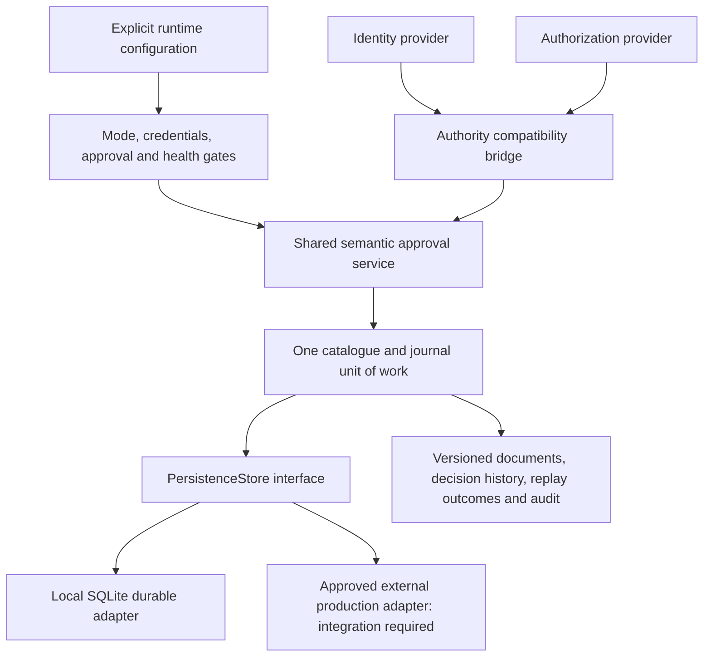

# Durable runtime and production integration boundaries

Implemented baseline: **2 November 2026**. This extends the [framework architecture](../architecture/business_prediction_framework_architecture.md), [semantic design](../architecture/semantic_binding_and_approval_design.md), [discovery foundation](foundation.md) and [semantic foundation](semantic_approval_foundation.md).

**Development and production are explicit execution modes using the same contracts, catalogue interfaces and semantic service.** Local durable execution is implemented with SQLite and development-only credential/authority providers. Production startup validation and external integration interfaces are implemented; **no approved production database, enterprise identity provider or organizational authorization service is connected**. Missing integrations fail closed rather than selecting local defaults.

## Implemented architecture



No business-question catalogue, department routing or fixed business column mapping is introduced. Source discovery still requires explicit adapters; no NOP data is automatically loaded or prepared. Persistence operates on technical metadata and governance records, not merged business datasets.

### Files added and compatibility

```text
src/business_prediction/persistence/
    __init__.py
    base.py
    sqlite.py
    coordinator.py
src/business_prediction/runtime/
    __init__.py
    config.py
    security.py
    secrets.py
    development.py
    logging.py
    factory.py
tests/
    persistence_support.py
    test_persistence_runtime.py
docs/development/durable_runtime.md
```

Only [semantic service wiring](../../src/business_prediction/semantics/service.py), [README](../../README.md) and [.gitignore](../../.gitignore) are modified. The service accepts optional `journal` and `operation_guard` dependencies; its original in-memory constructor and existing tests continue to work. Evidence registration additionally accepts an optional runtime authorization scope. The service now commits denied-action evidence before raising the denial and supports a persistent clock floor. These are justified additive runtime changes, not contract replacements.

All existing contract definitions, metadata schemas, earlier tests, reports, notebooks and design documents are preserved. The eight semantic contract versions remain `1.0`. The new storage schema uses SQLite `user_version=1` and payload `format_version=1.0`; incompatible stores are rejected. There is no silent migration of old JSON exports or ephemeral approval trust into the durable runtime.

## Persistence interfaces and guarantees

[PersistenceStore](../../src/business_prediction/persistence/base.py) defines an isolated transaction yielding `UnitOfWork(state, revision)`, defensive snapshots, health checks and resource closure. `StorageCapabilities` explicitly declares durability, transactions, immutable history, stale-write protection and recovery. `ProductionStorageAdapter` adds an operator-approved deployment reference. No database driver or SQL appears in business-processing logic; a future adapter implements the same transaction contract for an approved durable database.

The unit stores immutable source/schema metadata revisions, all governance documents, journal entries, command digests/outcomes, a clock floor, runtime bindings and audit history. Shared validation rejects replacement/deletion of old documents, command outcomes, history prefixes, storage identity or runtime bindings. The [durable coordinator](../../src/business_prediction/persistence/coordinator.py) reuses `MetadataCatalogue` and `GovernanceJournal`, including full contract/reference validation, rather than duplicating their lifecycle rules.

Each outer service operation acquires a storage unit of work and reloads the latest committed state. Catalogue writes, journal issuance, replay results and audit events then commit together. An exception rolls back the entire unit and restores the in-process cache. A denied operation commits its denial evidence and then raises; a failure before business commit records a separate safe failure event. No partially issued approval is returned as successful.

Journal head and storage revision are different: journal head orders governance commands; storage revision also changes for metadata/audit transactions. Caller `expected_head` is checked against fresh committed governance state. Idempotency binds the command ID to authenticated principal, operation and exact input. Replaying the same command returns its durable result; changing its actor/input fails. After an uncertain commit acknowledgement, reopen/recover and replay the **same** command ID/input, rather than inventing a new operation.

### Local SQLite implementation

[SQLiteStore](../../src/business_prediction/persistence/sqlite.py) uses standard-library `sqlite3`; requirements are unchanged. It requires an explicit on-disk path and an existing parent directory. `:memory:` is rejected. It uses WAL, `synchronous=FULL`, `BEGIN IMMEDIATE`, a bounded lock timeout and revision-checked updates. Independent processes/connections therefore serialize writes; stale service commands fail after the competing transaction commits.

The initial local adapter stores a checksummed JSON state in one database row. This keeps transaction/recovery semantics simple and testable. It materializes and validates the complete state and serializes writers: it is suitable for bounded local prototypes, **not a high-throughput production storage design**. A production adapter may use normalized tables or another implementation while preserving the unit-of-work invariants. Resource/performance testing, backups and retention need deployment-specific design.

Health checks verify SQLite storage version, payload integrity and `quick_check`; coordinator startup/use additionally checks every contract/reference, journal chain, document digest, command/outcome consistency, audit chain, absence of orphan governance records and persisted clock consistency. Unrecognized existing databases are refused, not overwritten. A future storage-format change requires an explicit migration strategy.

SQL transaction failures roll back. A failure while acknowledging commit returns `commit_indeterminate`; recovery/idempotent replay determines the outcome. The tests exercise both rollback and a simulated successful commit with a lost acknowledgement. This is not a claim of tested recovery from every disk, filesystem or hardware failure.

## Authentication and authorization

[IdentityProvider](../../src/business_prediction/runtime/security.py) authenticates an opaque credential/context and returns a typed identity containing verified principal reference, safe context reference, issuer and validity limit. The bridge rejects expired identities, wrong issuers and a context reference that directly repeats the credential. Caller-supplied names or role labels cannot establish identity.

`AuthorizationProvider` independently evaluates the authenticated identity, exact action/object revision, purpose/scope, policy and time. The compatibility bridge validates those returned bindings and requires a verifiable receipt. An identity success is not an authority grant. Unknown/missing/unavailable identity or authorization blocks the operation; there is no anonymous or allow-all fallback.

The existing authority interface is preserved through `ComposedAuthorityProvider`, so the semantic lifecycle remains shared. Existing approve/reject/clarify/revoke/supersede/use/change checks continue to record their authority evidence. The runtime additionally guards proposal creation, review submission and documentary evidence registration. Evidence registration through the runtime requires explicit `authorization_scope`; its purpose and field references must validate. There are no automatic business approvals.

Generic catalogue imports and `get()`/history interfaces are **trusted internal backend interfaces**, not authenticated public APIs. The application exposing them must enforce onboarding/read/access policy at its external boundary. Direct Python access, privileged database access and unreviewed connector code are outside this foundation's security boundary. No HTTP, MCP, LLM or UI service is created.

### Development providers and restart verification

[DevelopmentIdentityProvider](../../src/business_prediction/runtime/development.py) maps operator-configured local principals to secret references and compares opaque credentials. These are local prototype identities, not verified employees or business owners. `DevelopmentAuthorizationProvider` uses explicitly supplied finite grants, exact scopes and actions. No business roles are preconfigured. Without a matching grant, authority is denied.

Development receipts use HMAC-SHA256 with an operator-provisioned key of at least 32 bytes. The key is resolved outside the database. The signed receipt covers principal/context, action, exact subject reference, scope, policy, issuer, grant and validity. New provider instances can verify archived development receipts after restart when IDs and signing material remain consistent. Expired receipt freshness does not rewrite earlier legitimate decisions; the original decision-time checks and current approval/continuing-authority rules still apply.

Loss or rotation of the signing key makes old receipt verification fail closed; it does not fabricate renewed authority or migrate trust. This HMAC implementation is marked **development-only**, not an enterprise signing/key-management integration. The earlier test-only provider remains unchanged and cannot be selected as a production provider.

## Explicit execution modes and configuration

[RuntimeConfig](../../src/business_prediction/runtime/config.py) requires mode, selected storage/identity/authorization adapters and an explicit credential strategy. `from_mapping()` rejects unknown keys, including raw credential fields. Configuration contains named secret references, never secret values.

| Setting / dependency | Development | Production |
| --- | --- | --- |
| Shared service/contracts/catalogue | Same lifecycle and validation | Same lifecycle and validation |
| Storage | Local durable SQLite supplied; original in-memory service remains a separately documented prototype entry point | Approved external `ProductionStorageAdapter` required; SQLite/in-memory defaults rejected |
| Identity and authorization | Explicit development providers or configured adapters; no implicit credentials/grants | Installed non-development, non-test, production-capable integrations with matching deployment approval references |
| Credentials | Explicit secret references | Explicit secret-reference strategy or external/workload-identity integration; connector must verify readiness |
| Missing integrations/credentials | Startup/request fails clearly | Startup/request fails closed; never downgrades to development |
| Policy/provider changes | Exact binding check; explicit migration/review required | Same; deployment approvals and database controls also required |

Adapter factories are registered in trusted application code, not imported from a caller's configuration string. Production checks durable capability declarations, production adapter type, installed approval references, provider isolation, secrets and health. Approval references are deployment configuration bindings to installed adapters; they are **not independent business approvals or external identity proof**. An arbitrary string cannot make the built-in local adapters production-capable.

### Local persistent setup

Use a dedicated operational folder; [.gitignore](../../.gitignore) now excludes `/local_state/`, including database/WAL/shared-memory files. Original datasets are not newly ignored. If choosing another state directory, configure appropriate exclusion and permissions before storing sensitive metadata there. Do not put credentials, business data or runtime databases into commits.

The following is a local setup template. Provision the referenced environment values through your approved local secret mechanism first; no credential or receipt key is hardcoded. An empty grant list deliberately permits no semantic writes until explicit grants are configured.

```python
from pathlib import Path
from business_prediction.runtime import RuntimeConfig, AdapterFactories, start_runtime
from business_prediction.runtime.development import DevelopmentIdentityProvider, DevelopmentAuthorizationProvider
from business_prediction.runtime.secrets import EnvironmentSecrets
from business_prediction.semantics import ReviewPolicy

Path('local_state').mkdir(exist_ok=True)
config = RuntimeConfig(
    mode='development', storage_adapter='sqlite',
    identity_provider='local-identity', authorization_provider='local-authorization',
    sqlite_path='local_state/framework.sqlite3', credential_strategy='secret_references',
    secret_references=('env:NOP_LOCAL_CREDENTIAL', 'env:NOP_LOCAL_RECEIPT_KEY'),
)
factories = AdapterFactories(
    storage={},
    identity={'local-identity': lambda c, s: DevelopmentIdentityProvider(
        {'local-proposer': 'env:NOP_LOCAL_CREDENTIAL'}, s)},
    authorization={'local-authorization': lambda c, s: DevelopmentAuthorizationProvider(
        [], s, 'env:NOP_LOCAL_RECEIPT_KEY')},
)
with start_runtime(config, ReviewPolicy('explicit-local-policy', '1'),
                   factories, EnvironmentSecrets()) as runtime:
    health = runtime.health_check()
```

Run code from the project root with `PYTHONPATH=src`, as in the test command below. This template creates only operational state when deliberately executed. The task itself does not initialize a project database or access NOP datasets. Development grants are explicit configuration using discovered field references and approved purposes; they are not a business-question list.

### Production integration dependency

A production profile selects installed enterprise adapter IDs, deployment approval references and a credential integration strategy. The built-in factory registry has **no enterprise connectors**. `start_runtime()` therefore raises structured `missing_identity_integration`, `missing_authorization_integration`, `missing_storage_integration`, secret/readiness or unsafe-configuration errors until the appropriate adapters are supplied. No production connectivity was attempted or claimed in this task.

Before real production operation, owners must select/approve the durable database and transaction adapter, identity provider, authorization/policy service, secret mechanism, access controls, receipt verification/key rotation, migration/recovery process, retention and operational responsibilities. These are external dependencies and review work, not fabricated completed integrations.

## Startup, recovery and operational checks

`start_runtime(config, policy, factories, secrets, clock=None)` validates configuration/secrets, constructs separate security adapters, verifies production isolation/approvals and provider health, then initializes the selected storage and fully validates recovery. Persisted mode, policy digest and provider/storage identities are pinned: changing them does not silently transfer prior trust. Startup is recorded only after readiness passes.

`runtime.health_check()` returns explicit storage/provider readiness and catalogue consistency or a safe structured failure. Readiness means the configured technical dependencies pass their checks; it is **not prediction readiness, source authority or business acceptance**. `runtime.audit_history()` returns durable audit evidence. `close()` releases adapter resources; SQLite connections are scoped to transactions.

The journal persists the last accepted semantic clock instant; an older clock after restart is blocked. Audit events distinguish recording time from the semantic decision clock. Authorization denials retain evidence, failed writes do not leave phantom catalogue records, and command replay resolves acknowledged/unknown outcomes without duplicating decisions.

[StructuredJSONFormatter](../../src/business_prediction/runtime/logging.py) emits allowlisted event/level/time/operation/error/count fields and omits credential arguments, exception bodies and arbitrary extra objects. Logging setup is explicit and caller-owned; no log files, network sinks or background services are started. Durable audit holds necessary governance/authority metadata and must receive appropriate access/retention protection. Secrets are represented by redacted objects and resolved just in time through `SecretResolver`; `EnvironmentSecrets` implements the local/environment reference scheme. Other secret stores require adapters.

## Validation

```powershell
$env:PYTHONPATH = Join-Path (Get-Location) 'src'
.\.venv\Scripts\python.exe -B -W error -m unittest discover -s tests -t . -q
```

**105 tests pass: all 80 earlier tests plus 25 new tests**, with warnings treated as errors. The [new fixture](../../tests/persistence_support.py) and [runtime/persistence tests](../../tests/test_persistence_runtime.py) use synthetic data, temporary databases and development credentials only. Coverage includes a real fresh Python process, recovered approvals/rejections/revocations, durable replay, independent writers, full rollback, lost commit acknowledgements, immutable history, orphan/corrupt recovery, clock/policy changes, unauthorized operations, secret loss/key rotation, exact-version authority responses, provider isolation, missing production integrations and safe logs.

Existing reports/notebooks/original sources are preserved by hash comparison; original source hashes also match the validated inventory/quality source-integrity manifest. No existing test or contract definition is changed, no business data is cleaned/transformed/joined, and no feature/model work is performed. The only prior Python module modified is the additive semantic-service integration described above. Dependencies remain unchanged because SQLite, HMAC and operational utilities use the standard library.

## Security and storage limitations

- No production database/IdP/policy/secret-service connectivity, production deployment certification or actual business approval is established. The provided production path is a strict configuration/integration boundary that remains blocked without those dependencies.
- The local SQLite state is not encrypted by this package; HMAC keys and credentials are external. OS/database permissions, backups, secure transport for future adapters, trusted clocks, retention and key custody are deployment responsibilities.
- Hash chains detect accidental/inconsistent changes but are not a privileged-DB-owner tamper-proof ledger. Protect database write access and use independently reviewed production audit/receipt controls.
- Full-state snapshots and a serialized writer limit throughput and memory scalability. Network filesystems, replicas, failover, large-scale load and disaster-recovery procedures are not validated by the local tests.
- Source-format/contract migrations and old JSON-to-trusted-journal migrations are not automatic. Unknown versions and changed policy/provider/mode bindings stop startup pending explicit review.
- The runtime exposes trusted backend objects, not a public access-controlled API. External integrations must enforce read/onboarding permissions and must not accept arbitrary adapter factories, policy objects or direct database access from users.
- Conditions, external documentary retraction feeds and richer governance integrations retain the earlier stated limits. No target preparation, training, model lifecycle, inference, UI, LLM or MCP implementation is added.

The next activity requires approval to select and integrate the real production adapters and complete deployment security/recovery review. No additional milestone starts automatically.
