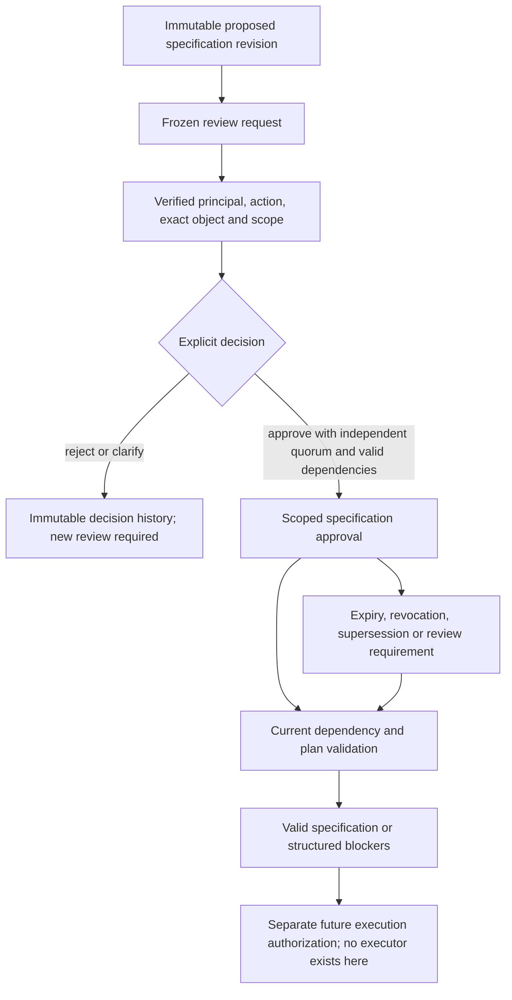

# Target, observation and preparation specifications

Implemented baseline: **3 November 2026**. This extends the [framework architecture](../architecture/business_prediction_framework_architecture.md), [semantic approval design](../architecture/semantic_binding_and_approval_design.md), [foundation](foundation.md), [semantic lifecycle](semantic_approval_foundation.md), [durable runtime](durable_runtime.md) and [requirement assessment](prediction_requirement_assessment.md). Those earlier documents remain unchanged historical baselines.

The implementation stores and reviews declarative specifications. It does not run an operation against source data. An approved field meaning, an approved target, an approved plan and permission to execute are separate decisions. No existing NOP business interpretation or preparation rule is approved by this implementation or its tests.

## Implemented components

```text
src/business_prediction/specifications/
    __init__.py
    contracts.py
    operations.py
    validation.py
    service.py
tests/
    specification_support.py
    test_preparation_specifications.py
docs/development/target_observation_preparation_specifications.md
```

| Component | Responsibility |
| --- | --- |
| [Contracts](../../src/business_prediction/specifications/contracts.py) | Eight additive version `1.0` types, nested specifications, exact references, structured errors and cross-record invariants |
| [Operations](../../src/business_prediction/specifications/operations.py) | Trusted, extensible validation of declarative operation parameters; deliberately no execution interface |
| [Validator](../../src/business_prediction/specifications/validation.py) | Read-only source, semantic, target, observation, dependency, temporal, relationship and leakage checks |
| [Service](../../src/business_prediction/specifications/service.py) | Authenticated proposals, sequential versions, independent business reviews, approval lifecycle and durable validation results |

The package depends on technical contracts, metadata and authorization interfaces. It contains no source names, business column mappings, department routing, predefined questions or model selection. New adapters and owner-defined concept IDs enter through the existing discovery/semantic framework; no business datasets are loaded automatically.

## Contracts

All types reuse `ContractDefinition`, `FieldSpec`, the four-part exact object reference, existing scope and evidence variants and the durable journal. References never mean latest. Proposal status is derived from immutable review records rather than an editable approved flag. Server-managed identity, revision, provenance and dependency fields cannot be injected into proposal bodies.

| Contract | Main contents and meaning |
| --- | --- |
| `PredictionTargetSpecification` | Optional exact requirement revision; business meaning; exact semantic binding and physical source/discovery/schema/table/field/position; native target grain, physical value type and declared characteristics; eligibility/inclusion/exclusion clauses; historical boundaries or explicit cross-sectional not-applicable reason; optional horizon and symbolic construction requirements; required approvals, evidence and limitations |
| `ObservationSpecification` | Exact target revision; observation grain; optional entity/identifier meaning references; event/observation time binding and basis, period, expected frequency and eligibility; native/construction-required alignment; historical/future boundaries; approved relationship dependencies. Non-temporal observations require an explicit, non-conflicting not-applicable reason |
| `RelationshipSpecification` | Exact left/right key tuples and snapshots, side/result grains, declared cardinality, null/unmatched/expansion policies, reconciliation requirements and contextual business evidence. It is not inferred from matching names, uniqueness or shared numbers |
| `DataPreparationPlanSpecification` | Exact target and observation; complete physical-source manifest; input/output grains; ordered declarative operations, relationship dependencies, quality/leakage controls, unresolved decisions and required approvals |
| `SpecificationReviewRequest` | Frozen exact subject, digest, scope, evidence, approval requirements, policy identity/digest, expiry, mandatory review date, conditions and limitations |
| `SpecificationReviewDecision` | Explicit approve, reject, request clarification, revoke or supersede decision; exact request/subject; authenticated principal and verifiable action/scope/object authority receipt; timestamp, rationale and affected/replacement approvals |
| `SpecificationApprovalRecord` | Exact approved object/digest, reviewed requirements and terms, distinct reviewers and decisions, deadlines and `execution_authorized=false` |
| `PreparationPlanValidation` | Exact plan, findings, validity/status, referenced approvals, operation-validator versions, governance head, assessment/expiry timestamps, limitations and `execution_authorized=false` |

Clauses carry an ID, definition and exact semantic-binding dependencies. They are owner-reviewed declarations, not executable expressions or evaluated eligibility outcomes. `value_characteristics` similarly retains declared business characteristics; it does not claim that arbitrary JSON constraints have been computed or proved. Native physical type and nonmissing population are checked separately against discovery.

Specifications require an explicit nonempty `required_approvals` list. Its labels identify the decisions covered by review; labels are not approver identities or authority grants. The configured authorization provider must establish that a principal is entitled to accept **all** those requirements for the exact subject, purpose and scope. More granular organizational routing remains an external policy integration responsibility.

Existing semantic `ApprovalRecord` contracts accept semantic bindings only. They were not widened or replaced. Specification approvals are separate records with the same underlying runtime authority bridge, review policy, journal transactions, audit and lifecycle principles. Approval of an identifier meaning never establishes primary-key validity by itself; the new contracts do not issue primary-key certificates.

## Operation declarations

Every operation carries `operation_id`, type/version, purpose, physical sources, semantic inputs, parameters, input/output grain, preceding dependencies, assumptions, evidence, risks, approval requirements, relationship references, information role and availability relative to the decision. An operation's approval requirements must be included in the frozen plan review.

| Declaration type | Parameters and checks |
| --- | --- |
| `type_interpretation` | Proposed value type and explicit nullable format |
| `missing_values` | Retain/flag/exclude/constant-fill/model-based proposal and explicit constant; missing constants are rejected and model-based fitting is blocked pending a separate training-fold contract |
| `invalid_values` | Retain/flag/exclude and owner-supplied validity definition |
| `duplicate_handling` | Retain/flag/exclude and comparison-field bindings; exclusion without comparison grain is blocked; repeated entities are never automatically errors |
| `date_time_interpretation` | Format, timezone, calendar and reject/explicit-rule ambiguity policy; explicit rules need current contextual documentary evidence; no date is parsed here |
| `filtering_eligibility` | Exact input binding, bounded comparison operator and literal value; membership requires an array; no SQL/Python is evaluated |
| `aggregation` | Group/measure bindings, technical aggregate method and reconciliation declarations; grain compatibility remains independently checked |
| `join` | Exact reviewed relationship, join type and reconciliation declarations; both key sides, grains and physical table scope must be explicit |
| `derived_target` | Symbolic method reference, output type and definition; blocked by the default validator because a description is not a trusted derivation verifier |
| `data_quality_validation` | Declared checks to run in a future separately authorized executor; no checks are represented as already executed |

These are technical operation categories, not business scenarios. Parameters have registered shapes and exact versions. Unknown operation types/versions, unexpected parameters and undeclared parameter bindings produce structured blockers. A plan cannot supply code, import paths or a callback to make its own unsupported operation trusted.

`OperationValidator` exposes only `validate(operation, context)`. Trusted application code can register another versioned validator through `OperationRegistry`; the caller cannot register one inside a contract. Extensions receive a metadata resolver and documentary-evidence checker, never an operation executor. Baseline source, semantic, scope, approval, information-role and grain checks still apply to extensions. Registration is a trusted application boundary and must undergo code review; the backend is not a sandbox for untrusted Python plug-ins.

The baseline dependency profile is an explicit serial chain: IDs must be distinct, dependencies must already exist, and each later operation must depend on its immediate predecessor. Branching/parallel transformation DAGs are not implemented. Any proposed grain change must be admitted by its operation validator and reconcile with the final observation specification.

## Review lifecycle and approval semantics



Each proposal revision names its exact immediate predecessor. An existing revision cannot be overwritten or forked from an outdated predecessor. Revision creation never transfers approval. Historical approvals of an earlier specification remain historical decisions; replacing them requires explicit retirement or expiry. A later source/discovery snapshot blocks reuse of affected specification contexts even when names and positions look unchanged.

Review terms freeze all requirements, evidence and policy identity/digest. The service uses the existing `ReviewPolicy`: positive distinct-reviewer quorum and independent review are enforced. A proposer or review submitter cannot review their own specification under the default policy. Duplicate votes and closed/expired review requests are rejected. Reject/clarify closes that request; a corrected proposal or another explicit review is required.

Approval is issued only after current dependency validation succeeds, without requiring approval of the object being reviewed. An observation therefore needs its exact target approved; a plan needs its exact target, observation, relationships and semantic dependencies approved. Unresolved conditions are preserved and remain `conditions_unverified`; no attestation is invented to satisfy them.

Revocation appends a decision against an exact approval. Supersession additionally requires an independently approved, currently valid compatible replacement in the same specification lineage/type/scope. An invalid or conditional replacement cannot be accepted because some other approval happens to be usable. Retired approvals cannot be silently revived. Historical decisions, original terms and earlier validation snapshots never change.

`specification_state()` is an internal projection of approval history, not proof that every dependency remains usable. External callers must obtain a fresh authorized plan validation; they cannot turn a projected state or old result into permission to execute. Revocation, expiry, provider failure, evidence change, source/schema changes and dependency supersession require reassessment.

## Public service interfaces

Obtain `runtime.specification_service(operations=None)` from an explicitly configured runtime.

| Method | Result / boundary |
| --- | --- |
| `propose(kind, fields, scope=..., evidence=..., context=..., command_id=..., expected_head=..., object_id=None, predecessor=None)` | Immutable proposed specification, after contract/reference and authorization checks |
| `submit_review(subject_ref, context=..., command_id=..., expected_head=..., expires_at=..., review_due_at=..., conditions=(), limitations=())` | Frozen review request; does not approve anything |
| `decide(request_ref, subject_ref, action=..., context=..., command_id=..., expected_head=..., rationale=...)` | Exact decision and optional approval references; supports approve/reject/request_clarification |
| `retire(approval_ref, action=..., rationale=..., context=..., command_id=..., expected_head=..., replacement=None)` | Append-only revoke/supersede decision |
| `inspect_for_review(subject_ref, context=..., command_id=..., expected_head=...)` | Authorized pre-review diagnosis excluding only the subject's own approval requirement; findings/time/head are durably recorded in the command outcome |
| `validate_plan(plan_ref, context=..., command_id=..., expected_head=...)` | Immutable `PreparationPlanValidation`, including the plan's own approval and all current dependencies |
| `get(ref)` | Trusted in-process exact historical read; external integrations must add read ACLs |

Mutations/inspections require explicit grants for `propose_specification`, `submit_specification_review`, `approve_specification`, `reject_specification`, `request_clarification_specification`, `revoke_specification_approval`, `supersede_specification_approval` or `validate_preparation_plan`, as applicable. Caller names, owner labels, approval IDs or free text cannot satisfy authority checks. Independent authentication and authorization remain the existing provider responsibilities.

The service does not add an LLM/MCP/API/UI integration or a new identity system. The teammate's integration may submit structured specifications and present structured findings. It cannot bypass the backend approval checks.

## Validation rules and evidence limits

Findings contain a stable `code`, category (`specification`, `approval`, `evidence`, `unsupported`, `leakage`), message, optional exact subject and optional operation ID. A validation is `valid_specification` only with no findings; otherwise it is `blocked`. Both results always state `execution_authorized=false`. Approval attempts with blockers fail with structured errors; `inspect_for_review` provides the detailed diagnosis.

Checks include:

- Exact physical references, positional/schema consistency, declared scope and later known source/discovery revisions. A sampled profile cannot certify the native target population.
- Current semantic usability through the existing semantic lifecycle, including revoked, superseded, expired, conditional, conflicting and stale interpretations. Documentary origin/context/expiry is checked; origin alone does not prove a business claim.
- Target meaning/type consistency, complete target evidence, required native grain and explicit eligibility/history. Unsupported target derivations are not approved automatically.
- Target/observation revision and grain agreement; historical/observation-period agreement; unambiguous complete temporal tokens, evidenced history bounds, non-overlapping future windows and compatible calendar/frequency/horizon declarations. Daily horizon duration is checked explicitly; arbitrary fiscal/working-day calendar arithmetic is not implemented.
- Explicit cross-sectional applicability when time is genuinely not required. A not-applicable reason cannot override a supplied horizon or conflicting time requirements.
- Approved exact relationship dependencies, composite-key side scope, known cardinality, contextual owner evidence, explicit null/unmatched/expansion policies and reconciliation declarations. Key semantics do not infer a primary key or validate live join cardinality.
- Complete source manifests, supported typed operations, dependencies, chain grain compatibility, declared approvals, unresolved decisions and quality/leakage controls. Unrelated tables cannot be introduced through an implicit operation or unrelated join.
- Target aliases used as predictors, unknown/post-decision predictor availability and learned treatments without fold contracts. These checks are not an exhaustive proof of leakage absence.

Validation resolves existing metadata only. It does not reread raw sources, count eligible rows, prove independence, recompute financial totals, test join coverage, parse ambiguous dates, evaluate clauses or measure target feasibility/performance. Such facts need authorized evidence and later approved execution checks. Reconciliation descriptions in plans are future obligations, not already passed results.

## Durability, compatibility and production boundary

The implementation reuses the semantic service's restricted metadata-command extension, durable journal, immutable catalogue, expected-head concurrency checks, transaction rollback, idempotent commands and audit receipts. Target/observation/plan versions, decisions and validation records survive restart. Generic catalogue import cannot manufacture trusted specification or approval records. An uncertain acknowledgement must be recovered/replayed with the same command ID and payload, not replaced by a new decision.

Changes to existing modules are additive and necessary:

- [Runtime factory](../../src/business_prediction/runtime/factory.py): registers new types before recovery and exposes the service constructor.
- [Durable coordinator](../../src/business_prediction/persistence/coordinator.py): protects the eight new journal-issued types from direct imports and validates their history on recovery.
- [Semantic service](../../src/business_prediction/semantics/service.py): allows only the six additional trusted technical command names; semantic contracts/approval meanings remain unchanged.
- [README](../../README.md): records implemented capabilities and links here.

Existing contract versions, storage format, architecture documents, reports, notebooks and tests are not replaced. An older application without the new contract registry must reject a store containing these records rather than discard them. No dependency is added and no project database is initialized; synthetic tests use temporary SQLite files.

Development-only providers remain explicitly configured local credentials/HMAC receipts and synthetic test evidence-origin verifiers. None supplies production identity or business authorization. Production-oriented contracts, interfaces and fail-closed startup are shared with development, but **no production database, enterprise identity provider, authorization policy service or documentary evidence connector is connected**. Those require approved external integrations and verified action/purpose/scope policies. Missing services never fall back to development providers.

The local SQLite adapter retains its bounded full-state JSON/serialized-write design. External read ACLs, real owner/policy routing, backups, retention, scalable production storage and live source-freshness notifications remain deployment responsibilities. Discovery can detect only changes that have been published; an unobserved file change requires new authorized discovery before later execution.

## Tests and preservation

Run from the repository root:

```powershell
$env:PYTHONPATH = Join-Path (Get-Location) 'src'
.\.venv\Scripts\python.exe -B -W error -m unittest discover -s tests -t . -q
```

The [synthetic fixtures](../../tests/specification_support.py) and [focused tests](../../tests/test_preparation_specifications.py) cover unfamiliar schemas, numerical/boolean outcomes, different native observation grains, cross-sectional and temporal specifications, missing/conflicting inputs, approval lifecycle and authorization failures, schema changes, ambiguous dates, unsupported operations, grain/join restrictions, leakage, restart recovery and preservation of discovery evidence. No original business data is used for preparation or tests.

Final validation passed **170 tests** (141 existing and 29 new) with warnings treated as errors, in **360.244 seconds**. Python syntax checks passed for the ten added/modified Python files. Links in this guide and README resolved successfully.

SHA-256 comparison against the implementation-start baseline found **254 existing files unchanged**, **four existing files modified** as listed above, **eight new files** and **no removed files**. All 17 original source files also matched the earlier source-integrity evidence. Earlier reports, notebooks, tests and contract definitions remained unchanged; requirements were unchanged and no project database was created.

No cleaning, transformations, permanent joins, aggregation, training datasets, features, training, model evaluation or inference was performed.

## Remaining boundaries and recommended next milestone

Native approved targets and reviewed relationship/operation declarations are supported. Derived-target and observation-grain construction still require a trusted construction verifier; registering an operation does not automatically bypass that target-level restriction. Heterogeneous source-grain scopes and arbitrary DAGs need additional scope/dependency design. Arbitrary declared characteristics, clauses, reconciliation obligations and working-day calendars are not independently proved by this validator.

After explicit approval, the recommended next milestone is to design the execution-authorization and immutable derivative/provenance contracts, bounded dry-run/reconciliation evidence and failure/rollback rules for a future preparation executor. Resolve relevant business decisions first. This recommendation does not authorize building or running that executor, preparing data or beginning ML development.
