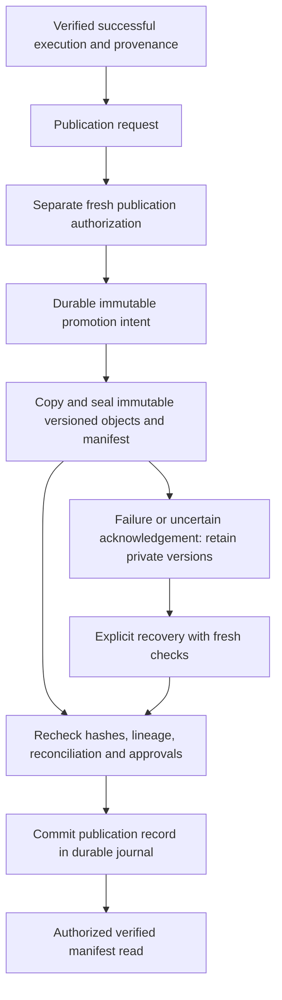

# Controlled preparation worker, artifact storage and publication

Implemented baseline: **3 November 2026**. This extends the [framework architecture](../architecture/business_prediction_framework_architecture.md), [semantic lifecycle](semantic_approval_foundation.md), [durable runtime](durable_runtime.md), [requirement assessment](prediction_requirement_assessment.md), [preparation specifications](target_observation_preparation_specifications.md) and [execution-control foundation](controlled_preparation_execution.md). Earlier documents remain unchanged historical baselines.

The local development implementation can execute a small registered operator set against **explicitly approved and authorized** sources. This milestone was exercised with synthetic sources only. It does not authorize or perform preparation of NOP sources, create NOP training datasets, generate features, train/evaluate models or implement inference, LLM, MCP or UI functionality.

## Components and integration

```text
src/business_prediction/worker/
    __init__.py
    contracts.py
    storage.py
    operators.py
    service.py
    publication.py
tests/
    worker_support.py
    test_worker_artifact_publication.py
docs/development/worker_artifact_publication.md
```

| Component | Implemented responsibility |
| --- | --- |
| [Contracts](../../src/business_prediction/worker/contracts.py) | Six additive version `1.0` contracts for claims, worker receipts, publication requests/intents/records and recovery evidence |
| [Storage](../../src/business_prediction/worker/storage.py) | Explicit local isolated storage, exclusive writes, content seals, typed row frames, measured descriptors, immutable publication versions and orphan detection; abstract production storage boundary |
| [Operators](../../src/business_prediction/worker/operators.py) | Trusted versioned registration, bounded pure operators, capability declarations and independent reconciliation |
| [Worker](../../src/business_prediction/worker/service.py) | Identity/fence/lease/source/approval checks, durable pre-execution claims, isolated source capture, operator dispatch, durable receipts and recovery without blind re-execution |
| [Publication](../../src/business_prediction/worker/publication.py) | Separate permission, complete integrity/lineage verification, immutable promotion intent, gated publication record, authorized read and explicit recovery |

The worker uses the existing `ControlledPreparationService`, specification validator, authority bridge, durable journal, execution states, artifact descriptors, operation receipts, reconciliation results and terminal provenance. It does not create a second approval engine or execution-state machine. Original discovery observations and hypotheses remain separate from business-approved definitions.

New records are `PreparationWorkerAttempt`, `PreparationWorkerReceipt`, `PreparationPublicationRequest`, `PreparationPublicationIntent`, `PreparationPublicationRecord` and `PreparationPublicationRecovery`. All use exact references, immutable revisions, authenticated owner identities, existing execution scope and structured validation. A worker receipt records measured completion/failure; execution success still requires the existing controller's reconciliation and finalization. Neither implies publication permission.

Existing changes are limited and justified:

- [Runtime factory](../../src/business_prediction/runtime/factory.py): register new contracts before recovery and expose `local_preparation_worker()`.
- [Durable coordinator](../../src/business_prediction/persistence/coordinator.py): include the six new types in protected journal issuance/recovery.
- [Semantic command allowlist](../../src/business_prediction/semantics/service.py): allow only the new trusted technical worker/publication command verbs.
- [Execution provenance text](../../src/business_prediction/execution/service.py): replace the earlier claim that no built-in operator was invoked with an accurate statement that operators/evidence come from the configured worker. Existing contracts, signatures, lifecycle logic and historical records are preserved.
- [README](../../README.md): link to this implementation guide.

No dependency is added. No existing test, architecture document, notebook, report or business source is replaced.

## Local configuration and public interfaces

Local artifact storage is explicit application configuration. Use a dedicated directory such as `local_state/artifacts/`, separate from original sources; the existing `local_state/` ignore rule covers deliberately created local operational state. Protect complete source directories using `protected_paths` where appropriate. This task creates no project artifact store or project database.

```python
from business_prediction.worker.storage import LocalArtifactStorage

# runtime, adapters and directories are explicitly configured by trusted code.
store = LocalArtifactStorage(artifact_directory,
                            protected_paths=original_source_directories,
                            max_rows=10_000, max_bytes=16 * 1024 * 1024)
worker = runtime.local_preparation_worker(store=store, adapters=adapters)
controller = worker.control
publisher = worker.publication_service()
```

The snippet is configuration, not business approval. Source onboarding/read permissions must already exist. No dataset name, table name, header name or business question is inferred from those variables.

| Interface | Behavior |
| --- | --- |
| Existing `controller.request/authorize/begin` | Separate request, verified operational authorization and active bounded/fenced execution; a validated plan is insufficient |
| `worker.run_next(request_ref, operation_id=..., fence_token=..., context=..., command_id=..., expected_head=...)` | Claim and execute only the next exact registered operation; write isolated artifacts and checkpoint verified evidence |
| Existing `controller.finalize(...)` | Require every completed/reconciled operation and current authorization; no automatic publication |
| `worker.recover(...same request/operation/fence...)` | Checkpoint a complete sealed receipt under current permission/lease, or record interruption when the receipt is incomplete; never infer completion from an output file |
| `worker.scan_orphans(request_ref, context=..., command_id=..., expected_head=...)` | Authorized durable report of unreferenced/corrupt staging; retain files, no deletion |
| `publisher.request(execution_ref, publication_key=..., context=..., command_id=..., expected_head=...)` | Freeze exact successful state and matching provenance; does not grant publication |
| `publisher.publish(proposal_ref, context=..., command_id=..., expected_head=...)` | Require fresh publication permission, verify closure, promote immutable copies and commit the publication record |
| `publisher.recover(proposal_ref, context=..., command_id=..., expected_head=...)` | Explicitly authorized idempotent promotion/commit recovery; no operator re-execution |
| `publisher.read(record_ref, context=..., command_id=..., expected_head=...)` | Return a verified manifest/version list only for a committed publication record with fresh read permission and valid business approvals |

New grants are `execute_preparation_operator`, `recover_preparation_worker`, `request_preparation_publication`, `publish_preparation_artifacts`, `recover_preparation_publication` and `read_preparation_publication`. They supplement existing execution-control grants; they are not automatically granted to a worker, execution authorizer or caller with a successful result. Identities are authenticated through the existing provider, never through supplied owner/role labels.

## Worker lifecycle and bounded operators

1. Verify current exact execution authorization, source/discovery versions, approved target/observation/relationship/plan meanings, authenticated pinned worker, active lease/fence and operation sequence.
2. Commit a `PreparationWorkerAttempt` with exact operation digest, implementation/capability versions and row/byte limits.
3. Write an exclusive durable started marker **before** operator invocation. Existing started work without a complete receipt is never automatically rerun.
4. Capture one explicitly authorized source table using existing read-only adapters and source-integrity checks, or reuse the exact preceding accepted artifact. Project only declared physical fields; reject absent ragged cells rather than replacing them with null.
5. Recheck permission/lease/source state, invoke only registered trusted pure code and enforce bounded output. Recheck before writes and receipt creation.
6. Seal accepted and rejected partitions, record a durable storage receipt and journal-issued worker receipt, then pass it to the existing controller for independent reconciliation/checkpointing.

`PreparationOperatorRegistry` accepts trusted `PreparationOperator` implementations only. Each has a declaration version, implementation version, input/parameter validation, row/schema/grain/idempotency capabilities, a pure `apply()` and separate `reconcile()`. The implementation/capability registry signature is pinned by execution authorization and each attempt. Changed registrations or limits do not silently inherit permission. Operators receive cloned typed row batches, not source paths, credentials, storage writers or arbitrary import instructions.

The local set is deliberately bounded:

| Operator | Implemented behavior / restrictions |
| --- | --- |
| `data_quality_validation` | Preserve native rows/schema and measure `native_rows`, `row_count`, `schema`, `missing_counts`, `duplicate_count`, `content_integrity`. Arbitrary prose/business assertions are rejected, not represented as evaluated |
| `filtering_eligibility` | Execute an explicitly reviewed literal predicate on one bound field. Retain accepted and rejected records separately. Support strict native finite integer/float/boolean/text comparisons and explicit null checks; no implicit numeric/date/locale coercion |
| `type_interpretation` | Assert an evidenced native type, or interpret canonical integer text into signed 64-bit integers using the exact approved `canonical_integer_text` format. Reject spaces, leading zeroes, separators, decimal/date tokens, mixed/unknown representations and out-of-range values. No locale/date guessing |

Type conversion cannot redefine target, time or identity fields through a role label or physical alias. Native assertions do not create a new business meaning. Negative values and zero are preserved; no business invalidity is inferred. Null predicates test actual typed nulls; blank text is not converted to null. Missingness statistics include nulls and blank/whitespace text, preserving the original tokens and unknown logical type of entirely blank columns.

Joins, aggregation, observation-grain changes, derived business targets, financial calculations, deduplication/deletion, imputation, model-based treatments and arbitrary expressions are not implemented. Unregistered or unsupported operations fail closed. The operator capability list is technical metadata, not a catalogue of business questions, scenarios or question-to-model mappings.

## Artifact storage and lineage

`ArtifactStorage` defines health, source isolation, exclusive object creation, verified reads/descriptors, idempotent promotion and orphan discovery. `LocalArtifactStorage` uses an explicit store identity and execution-scoped namespaces: `inputs`, `intermediate`, `final`, `claims`, `receipts`, `published`.

Opaque locators contain validated server tokens. Plan parameters and publication keys are never interpolated into filesystem paths. Root/source overlap, traversal, symlink/reparse paths and hardlinked artifact files are rejected. Initialization requires an empty directory or a recognized existing store. Sealed files are never replaced through the API; input, intermediate and final artifacts remain distinct.

Each object is created exclusively, flushed/fsynced and paired with an exclusive SHA-256/byte-size seal. Read-only file attributes reduce accidental writes. Every read verifies the seal and typed schema; descriptors are freshly measured defensive values. Hashes, row counts, duplicate counts, missingness and schema are measured from the artifact, not accepted from a business request.

Payload lineage pins execution, authorization, plan, exact original source/discovery/schema references, operation digest and worker attempt. Physical row ordinals are provenance metadata, not generated business identifiers or ML features. Original typed input values are retained in the input artifact, including before a permitted interpretation/filter. No source file is opened for writing.

**Local filesystem seals are not production-grade immutability or ACLs.** A privileged OS user can alter/delete files or permissions; verification detects changed content, but the application does not defeat an administrator. Symlink checks reduce accidental/untrusted-path risks and do not provide a hostile-process sandbox or eliminate filesystem TOCTOU races. File fsync is not a tested cross-platform power-loss/disaster-recovery guarantee. Production requires an independently approved immutable/versioned object store and isolated worker.

## Reconciliation and publication lifecycle

The existing execution controller remains authoritative for state and terminal provenance. `WorkerReconciliation` independently checks the sealed inputs/outputs with the registered operation's reconciliation:

- Inspection preserves exact typed cells, schema, physical row order/ordinals and rejection emptiness.
- Filtering partitions every original physical row exactly once, with no overlap/value changes and the explicit predicate true/false in the correct partition.
- Interpretation preserves unrelated fields and record identity, changes only the approved logical type and checks exact integer-value equivalence.
- Accepted/rejected counts must match measured partitions. Unsupported reconciliation does not pass by row equality.

Publication rechecks **all** source/artifact hashes, receipt sequence/digests, operation completion, reconciliation, source/schema compatibility, exact plan/business approvals, operational authorization and registered implementation versions. It verifies that final accepted plus all rejection partitions across the chain cover the original input once. Source and business approvals are checked again after verification/promotion. Existing leakage/grain restrictions remain in force; arbitrary eligibility definitions and decision-time availability still depend on business-approved evidence.



Physical promotion is **not** consumer publication. The backend read interface requires both a committed `PreparationPublicationRecord` and a valid physical manifest/objects. A database failure after copying leaves private, uncommitted versions; the backend does not expose them. Raw filesystem access is not a public serving interface and must remain restricted by OS policy locally and storage ACLs in production.

Publication keys deduplicate exact intents; conflicting key/execution combinations are rejected. Each new execution/publication gets an immutable version, preserving earlier records/objects. A successful execution or a cached historical response is not fresh publication/read permission. Safety checks, reads and recovery-authority checks use fresh internal audit nonces on every invocation; reusing a caller correlation/command ID cannot replay an old access decision after revocation. Business writes remain idempotent. Callers refresh the expected journal head when making another access/recovery call.

Publication currently requires its original operational authorization to remain current; late publication after expiry needs a future explicit authorization-renewal design, not silent extension. Published reads use fresh read rights and current business approval/integrity checks; they do not run transformations or authorize ML.

## Failure recovery and audit

- Expected journal heads and payload-bound command replay preserve existing concurrency/idempotency controls. Worker attempts, receipts, publication intents and records are protected against generic catalogue imports.
- A complete sealed worker receipt can be checkpointed after restart under the same valid fence/lease/versions; no operator is rerun. An incomplete receipt/started marker leads to interruption and retained orphans. A new execution attempt requires a new explicitly authorized request.
- Lease expiry, stale sources, approval revocation or unsupported parameters stop progress. Buggy operator output can be sealed but cannot become successful/published when independent reconciliation fails.
- Publication copying is idempotent by immutable intent/object identity. Lost acknowledgements are resolved by verified state/replay. A missing seal is repaired only when all existing bytes exactly match the pinned complete immutable source; corrupt/truncated bytes are not overwritten or treated as complete.
- Publication failure and recovery are append-only evidence. An uncertain acknowledgement may coexist with an actually committed publication record; visibility is determined by verified durable state, never inferred from an exception alone.
- Orphan reports distinguish sealed-unreferenced and partial/corrupt artifacts. Known successful publication objects are not classified as staging orphans. No automatic cleanup/deletion touches sources or versions.
- External filesystem and metadata commits are not one distributed transaction. The intent/promotion/record protocol and gated reader handle uncertainty; they do not claim atomicity across unrelated storage systems.

## Production-oriented interfaces and known limits

`PreparationWorker` and `ProductionPreparationWorker` define external worker execution/recovery, health and identity/isolation evidence. `ProductionArtifactStorage` adds independently authorized access, recovery and provider-managed retention to the storage protocol. Production publication calls those verification/access interfaces and requires approved production-capable worker/storage implementations. Local workers/stores are rejected in production, with no fallback.

No enterprise identity, policy service, durable production database, immutable source connector, production worker, object store, publication service or independent audit service is connected. Real deployments require approved credentials/policy, immutable snapshots, sandbox/resource/fence enforcement, storage ACLs, content/version verification, audit retention, backups, key custody and recovery procedures. Capability labels are not deployment certification; only trusted backend code may register reviewed integrations.

The local worker supports one native source table per execution and a serial dependency chain. Typed JSON artifacts are bounded by configured row/byte budgets; they are not a scalable training storage format. The shared full-state SQLite runtime remains serialized and expensive for large histories. Streaming/distributed jobs, arbitrary schemas/conversions, fiscal-calendar interpretation, orphan deletion, corrupted-promotion replacement workflows and asynchronous lease renewal are not implemented. Production needs load, power-loss, isolation and retention validation beyond these synthetic tests.

## Validation and completion boundary

```powershell
$env:PYTHONPATH = Join-Path (Get-Location) 'src'
.\.venv\Scripts\python.exe -B -W error -m unittest discover -s tests -t . -v
```

The [synthetic fixture](../../tests/worker_support.py) and [focused tests](../../tests/test_worker_artifact_publication.py) cover different memory/CSV schemas, native inspection, strict filtering/interpretation, original-byte preservation, isolation, tampering, budgets, authorization/fencing, source changes, lease expiry, revocation during execution/promotion, independent reconciliation failure, duplicate publication, interruption, restart, orphan detection, partial promotion and lost acknowledgements. Repeated access/recovery requests after revocation are covered separately from idempotent writes.

Validation completed on **3 November 2026**:

- The complete suite passed: **237 tests (202 existing and 35 new)** in **1,591.423 seconds**, with warnings treated as errors. No existing test was changed.
- All **17 original source files** matched their recorded SHA-256 hashes in the existing source-integrity report. Only temporary synthetic sources were used for execution/publication tests.
- Against the initial 274-file preservation snapshot, **269 files were unchanged**, **5 integration/documentation files were modified**, **9 files were added**, and **none were removed**. Existing reports, notebooks, architecture documents, test files and contract definitions remain unchanged; the additive contract module is separate.
- README and this guide's local file links resolve. All 12 added/modified Python files parse successfully. No dependency was added, and no project operational database or artifact store was created.

These checks validate the bounded local implementation and tested failure behavior; they do not certify connected production storage, identity, worker isolation or disaster recovery.

Stop after this implementation. The recommended next milestone, only with explicit approval, is deployment-specific worker/object-store integration and performance/recovery hardening, alongside resolution of actual business approvals. This document does not authorize running NOP preparation, constructing NOP training datasets, feature engineering, ML training or inference.
