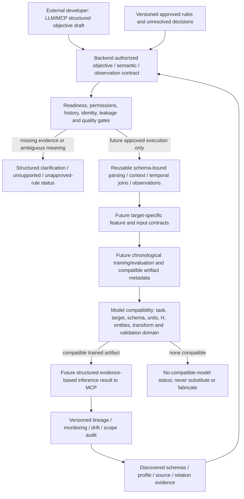

# Data preparation strategy and business rule specification

Specification baseline: **2026-11-02**; current inventory, quality, relationship and feasibility evidence. Scope: **17 source files, 14 Excel workbooks / 17 worksheets plus 3 GST CSV tables, 20 tables, 521 columns, 37 date-related fields, 135 identifier candidates and 424 existing quality issue entries**.

## Decision and authorization boundary

This is a backend/data specification only. **No cleaning, source transformation, dataset join, aggregation of targets, feature engineering, label generation, training, packaging, inference engine, LLM/MCP integration or UI has been executed or implemented.** Source datasets and every earlier validated report/notebook remain unchanged. Specification-rendering code reads existing evidence; it is not a reusable preparation runtime.

There are **zero currently approved business joins** and **zero newly approved business definitions**. Confirmed project constraints are immutability, documentation-only scope, backend-only development and no predefined questions/scenarios. Verified observations are evidence, not business rules. Proposed safeguards still need implementation approval; semantic/financial/identity/time decisions require the accountable NOP owner. The specification does not authorize itself to execute any treatment.

## Evidence and review coverage

All earlier reports and four existing notebooks were reviewed without reexecution; CSV evidence was parsed, all existing workbook sheets were streamed, narrative/diagram content was read or decoded, and core inventory/quality/relationship/feasibility workbook tables were cross-checked against their CSV companions. Review scope is recorded in `reviewed_artifacts` in the blueprint workbook and [review ledger](preparation_evidence/reviewed_artifacts.csv). Source hashes were checked against the validated source manifest; full source profiles were reused instead of rerunning earlier workflows and overwriting their reports.

References: [inventory validation](../data_inventory/inventory_validation_report.md), [quality assessment](../data_quality/data_quality_report.md), [quality issue register](../data_quality/issue_register.csv), [relationship report](dataset_relationship_report.md), [identifier/relationship matrix](identifier_relationship_matrix.xlsx), [granularity evidence](dataset_granularity_report.xlsx), [logical model](data_model_diagram/README.md), [prediction feasibility](business_prediction_feasibility_report.md), [target evidence](prediction_target_mapping.xlsx), [prediction data requirements](prediction_data_requirements.xlsx).

## Preparation requirements for every source table

| table | rows_below_header | columns | record_grain_candidate | quality_issue_entries | intended_future_use |
| --- | --- | --- | --- | --- | --- |
| Customer Master Report 1.xlsx :: Sheet1 | 40 | 35 | Customer-master record candidate; repeated codes in some extracts | 15 | Candidate entity/reference view; current extracts cannot supply historical eligibility or time-varying attributes without additional evidence. |
| Customer Master Report 2.xlsx :: Sheet1 | 5015 | 35 | Customer-master record candidate; repeated codes in some extracts | 33 | Candidate entity/reference view; current extracts cannot supply historical eligibility or time-varying attributes without additional evidence. |
| Exchange Rate 1.xlsx :: INR to JPY | 7 | 7 | Monthly currency-pair period record candidate | 10 | Separate period reference evidence; explicitly synthetic examples not production rates without authority approval. |
| Exchange Rate.xlsx :: INR to JPY | 22 | 7 | Monthly currency-pair period record candidate | 1 | Separate period reference evidence; explicitly synthetic examples not production rates without authority approval. |
| GSTR1_Credit_Debit_Note 1.csv :: (CSV table) | 6 | 64 | Credit/debit reporting detail candidate; observed rows per scoped note assessed separately | 20 | Separate reporting/adjustment event views with scoped identity and sign/filing contract; reconciliation without counting alternate representation as extra activity. |
| GSTR1_Credit_Debit_Note 2.csv :: (CSV table) | 279 | 64 | Credit/debit reporting detail candidate; observed rows per scoped note assessed separately | 39 | Separate reporting/adjustment event views with scoped identity and sign/filing contract; reconciliation without counting alternate representation as extra activity. |
| GSTR1_Invoice.csv :: (CSV table) | 337 | 68 | Tax reporting line candidate, scoped invoice number repeated across lines | 39 | Separate reporting/adjustment event views with scoped identity and sign/filing contract; reconciliation without counting alternate representation as extra activity. |
| Inventory Audit Report as on 200327.xlsx :: Sheet1 | 108129 | 13 | Mixed item labels, opening-balance lines and movement details | 31 | Potential typed movement/state views only after approved group reconstruction and balance/snapshot semantics; no current stock panel. |
| Inventory Audit Report as on 200926 1.xlsx :: Sheet1 | 162 | 13 | Mixed item labels, opening-balance lines and movement details | 26 | Potential typed movement/state views only after approved group reconstruction and balance/snapshot semantics; no current stock panel. |
| Inventory Audit Report as on 200926.xlsx :: Sheet1 | 162 | 13 | Mixed item labels, opening-balance lines and movement details | 21 | Potential typed movement/state views only after approved group reconstruction and balance/snapshot semantics; no current stock panel. |
| Item Master Lists 1.xlsx :: Item Lists | 150 | 19 | Item-master record candidate with stock and commercial attributes | 8 | Candidate entity/reference view; current extracts cannot supply historical eligibility or time-varying attributes without additional evidence. |
| Item Master Lists 2.xlsx :: Item Lists | 5015 | 19 | Item-master record candidate with stock and commercial attributes | 22 | Candidate entity/reference view; current extracts cannot supply historical eligibility or time-varying attributes without additional evidence. |
| Sales Invoice Details 1.xlsx :: Sheet1 | 100188 | 43 | Invoice goods/service detail candidate with repeated document totals | 65 | Separate document/detail event views; approved target contract may create bucket or decision observations only after identity/time/measure gates. |
| Sales Invoice Details.xlsx :: Sheet1 | 337 | 43 | Invoice goods/service detail candidate with repeated document totals | 29 | Separate document/detail event views; approved target contract may create bucket or decision observations only after identity/time/measure gates. |
| Sales Order Report 1.xlsx :: Sheet1 | 1098 | 26 | Order item/service-like detail record; not one row per order | 14 | Separate document/detail event views; approved target contract may create bucket or decision observations only after identity/time/measure gates. |
| Sales Order Report 2.xlsx :: Sheet1 | 100286 | 26 | Order item/service-like detail record; not one row per order | 46 | Separate document/detail event views; approved target contract may create bucket or decision observations only after identity/time/measure gates. |
| Sales_Order_Data_202609.xlsx :: Customer list | 43 | 4 | Reference customer row with sparse alternate code and BP_CODE | 4 | Optional semantic reference view; scope, historical membership and allowed production use must be approved; not an outcome history. |
| Sales_Order_Data_202609.xlsx :: Country master | 11 | 5 | Country-code row with multilingual names and segment | 0 | Optional semantic reference view; scope, historical membership and allowed production use must be approved; not an outcome history. |
| Sales_Order_Data_202609.xlsx :: PTC_NOPI | 60 | 8 | Product-code row in agency/product classification list | 0 | Optional semantic reference view; scope, historical membership and allowed production use must be approved; not an outcome history. |
| Sales_Order_Data_202609.xlsx :: PCT_NOPJ | 33 | 9 | Product-code row in agency/product classification list | 1 | Optional semantic reference view; scope, historical membership and allowed production use must be approved; not an outcome history. |

[Business rule register](business_rule_register.xlsx) contains the complete `table_preparation_requirements` and `column_preparation_requirements` sheets: exact file/sheet, all 521 column positions, original header JSON/display labels, observed types, missingness, all relevant date fields, all 135 identifier candidates with their roles and counts, important evidence-cited fields, 424 linked issue IDs, intended use, grain evidence and confirmation needs. All 20 tables require business confirmation before predictive semantic use. No column projection, renaming or source selection is approved by a diagnostic importance flag.

Actual source names are citations/bindings in the evidence register, **not constants to embed in reusable preparation operators**. The original PCT_NOPJ blank header is retained as JSON null and a positional display locator; its 33 NOPJ values do not authorize inventing a business name. Every unused field remains in raw evidence; target-specific projection is a later approved contract decision.

## Rule status and required business decisions

| rule_id | domain | decision_or_rule | status | specification | owner_role_to_confirm |
| --- | --- | --- | --- | --- | --- |
| BR-001 | Governance | Immutable original sources and prior validated evidence | Confirmed project constraint | Never overwrite, recalculate or mutate sources; preserve lineage and hashes. | Project/data owner |
| BR-002 | Authorization | Specification only; no preparation execution | Confirmed project constraint | Document proposed rules now. Cleaning, data joins, features, training and inference require separately authorized work. | Project owner |
| BR-003 | Architecture | No predefined business-question or scenario catalogue | Confirmed project constraint | Reusable operations bind authorized semantic/schema contracts; no fixed questions, question-dataset/model routes or universal dataset/model. | Backend owner |
| BR-004 | Interface | Backend-only; external LLM/MCP integration boundary | Confirmed project constraint | Other developer owns language interpretation/MCP integration. Specify structured objective/clarification/result contracts; create no UI/chatbot/interpreter here. | Backend and integration owners |
| BR-005 | Authority | Production source and version precedence | Unresolved business decision | Approve issuer/company, extraction scope, authenticity, history and authoritative version. File size, suffix and apparent recency cannot select it. | ERP/source owners |
| BR-006 | Sales | Meaning of sales and qualifying event | Unresolved business decision | Choose order booking, invoice issuance, shipped/fulfilled units or an approved financial metric explicitly; do not substitute another meaning. | NOP sales/process owner |
| BR-007 | Sales | Cancellation, return and adjustment treatment | Unresolved business decision | Approve lifecycle/sign/void policy and information available at decision time; current status cannot retrospectively define past known state. | NOP sales and finance owners |
| BR-008 | Identity | Customer and party namespace | Unresolved business decision | Approve customer/account/GST-registration scope and historical crosswalk; names or GSTIN alone are not guaranteed account identifiers. | Master data owner |
| BR-009 | Identity | Product, service and foreign-code namespace | Unresolved business decision | Approve item/manufacturer/agency/service codes and versioned mappings; category/HSN/description are not unique product identities. | Master data / product owners |
| BR-010 | Identity | Document scope and stable line identity | Unresolved business decision | Confirm issuer/year/series and persistent line IDs upstream; SO number alone and row ordinals cannot establish business identity. | ERP owner |
| BR-011 | Evidence | Current invoice/order key evidence is not approval | Verified evidence only | Small invoice has 234 internally consistent references; small order 275/299 raw SO groups vary customer and 278 vary posting date. These support review, not new keys. | ERP/process owners |
| BR-012 | Lineage | Technical record locators versus business identifiers | Proposed technical safeguard | Reference raw source version/hash, relative file, sheet/record and column position as technical lineage only; never invent customer, product or transaction IDs from sequence numbers. | Data engineering owner |
| BR-013 | Financial | Additive monetary target and recognition basis | Unresolved business decision | Approve reported taxable/gross/net proxy, currency, scope, signs, freight, discounts, tax inclusion, rounding and adjustments; recognized revenue requires ledger evidence. | Finance owner |
| BR-014 | Financial | Repeated document and cumulative totals | Proposed technical safeguard | Do not sum a repeated header amount or cumulative balance as independent lines. Form document/state views only after determinants and consistency are approved. | Finance / inventory owners |
| BR-015 | Financial | Arithmetic screening is not correction authority | Verified evidence only | Existing absolute 1 and relative 0.005 tolerances are provisional diagnostics, not approved accounting rules. Do not recalculate original amounts to force equality. | Finance owner |
| BR-016 | Dates | Field-specific formats and two-digit centuries | Unresolved business decision | Approve exact formats per source/field/version; retain alternative DMY/MDY readings and raw tokens. No global dayfirst/default century or flexible silent parsing. | Source/process owners |
| BR-017 | Dates | Excel serial interpretation and impossible dates | Unresolved business decision | Approve numeric date role, workbook epoch, day conventions and plausible domain before serial interpretation; impossible dates require evidence-based owner resolution, not rollover. | Source owners |
| BR-018 | Dates | Time basis, fiscal periods and monthly attributes | Unresolved business decision | Approve event versus posting/reporting/update/availability time, timezone/calendar, period closure and fiscal boundaries. Month-only values need proven year; 2027-03 is a period, not an observed day. | Business process / finance owners |
| BR-019 | Dates | Future/planned records and information availability | Unresolved business decision | Separate actual, planned and known-in-advance values. Keep raw future records; eligibility of future plans as covariates requires proof of availability at the cutoff. | Process / data operations owners |
| BR-020 | Coverage | Missing activity versus zero and partial periods | Unresolved business decision | Approve observation calendar, capture completeness, eligibility and zero policy before dense panels or no-event labels. Unobserved dates are not zeros. | Business / data operations owners |
| BR-021 | Quantity | Units, pricing quantities and goods/service semantics | Unresolved business decision | Approve product/UOM/pricing-unit conversions and goods/service measure separately. Manual UOM and zero service-like quantities do not define physical demand or service hours. | Product / sales owners |
| BR-022 | Numerical | Negative, zero and unusual values | Unresolved business decision | Retain negatives, zeros, fractions and outliers unless business context establishes an error; no automatic abs, clipping, deletion or zero-as-missing. | Finance / operations owners |
| BR-023 | Missingness | Requiredness, optional fields and placeholders | Unresolved business decision | Define requiredness by record role and lifecycle. Preserve blank versus placeholder/error token versus not-applicable; never blanket fill with zero or forward/backward fill. | Source/process owners |
| BR-024 | Duplicates | Exact, payload and transaction-signature duplicate handling | Unresolved business decision | Keep all candidates until stable grain, provenance and occurrence policy decide legitimacy. Group membership count differs from excess-row count. | ERP / business owners |
| BR-025 | Representations | Case, Unicode, spelling, flags and numerical text | Unresolved business decision | Only after namespace/domain/unit approval may a derived normalization or strict parser be applied. Preserve leading zeros, raw tokens and collisions; fuzzy suggestions never auto merge. | Master data / source owners |
| BR-026 | Inventory | Group-label propagation and row classes | Unresolved business decision | Approve block boundaries, item scope, opening/movement/subtotal/summary roles and warehouse/document semantics before group reconstruction. No blanket fill-down. | Inventory/ERP owner |
| BR-027 | Inventory | Stock state and snapshot semantics | Unresolved business decision | Approve as-of balance, signed movement types, opening state, snapshot cadence, reservations and completeness. Current master stock/update attributes are not historical snapshots. | Inventory owner |
| BR-028 | GST | Scoped document reconstruction and invoice reconciliation | Proposed technical safeguard | Keep scoped prefix/series/number/suffix reconstruction diagnostic until approved; use GST/invoice as alternate representations, not extra sales. Description is not a persistent line ID. | Finance / ERP owners |
| BR-029 | GST | Tax, credit/debit signs and filing versions | Unresolved business decision | Approve tax applicability, note sign/stock impact, original-invoice allocation, filing/amendment version and reporting period; do not infer them from arithmetic alone. | Finance/tax process owner |
| BR-030 | Joins | Semantic and point-in-time join approval | Unresolved business decision | No candidate relationship is currently approved. Declare scoped keys, temporal predicates, allowed cardinality, null/unmatched and expansion policy per join contract. | Business and data owners |
| BR-031 | Joins | Row-preserving candidates still require scope approval | Verified evidence only | 27 raw-key directions currently have matched keys and unique nonblank targets; 20 raw-key tested directions expand. Counts are observations, not approval. | Business/data owners |
| BR-032 | History | Decision windows, population and label maturity | Unresolved business decision | Specify t, H, eligibility/exposure, qualifying outcome, observation closure, availability and reporting lag. Unknown/censored windows are not negatives. | Business / data operations owners |
| BR-033 | Leakage | Chronological fitting and event separation | Proposed technical safeguard | Plan train/development/final chronological boundaries, matured training labels, point-in-time joins and related-event separation; fit transforms inside training folds only. | ML/data owner |
| BR-034 | Provenance | Synthetic and sample material | Unresolved business decision | Production-use status must be explicit; marked synthetic rate/reference data cannot become production observations by cleaning. | Source/business owners |
| BR-035 | Schema | Unnamed PCT_NOPJ field | Unresolved business decision | Retain original blank header and 33 NOPJ values, tracked by position. Agency/source meaning is only a hypothesis; do not invent a column name. | Product/reference owner |
| BR-036 | Release | Preparation approval and derivative release | Proposed technical safeguard | Require rule decisions, source/semantic versions, tests, lineage, counts and quantity/financial conservation before releasing a derivative for an approved contract. | Business / data owners |

Each register entry includes acceptance criteria, evidence and current authorization flags. No definition becomes approved merely because the column is populated, unique, apparently similar to another source or arithmetically plausible. The business owner must provide decision, scope, source/field/rule version, rationale, effective/available dates and acceptance criteria before status changes. No owner/person identity or business approval is fabricated; roles identify who should decide.

Specific dependencies include:

- **Sales:** distinguish booked order, issued invoice, shipped/fulfilled quantity and value. Current cancellation states cannot define what was known at a historical cutoff. Small SO number groups vary customer in 275/299 groups and Posting Date in 278/299; source/company/year and line scope must be resolved upstream.
- **Invoice grain:** the small invoice has 337 detail rows / 234 full references with consistent observed party/date/document total per reference, but no approved primary key or stable line ID. Do not declare a description, row ordinal or document+product tuple an upstream line key simply because it is unique here.
- **Finance:** distinguish reported taxable/gross/invoice proxies from recognized revenue, cash receipts and realized margin. Repeated `Invoice Total Include GST`, GST `Invoice_Value`, credit/debit header amounts and cumulative stock measures are nonadditive at detail grain. Discount/freight/tax/sign/unit/currency and revision rules remain open; earlier arithmetic tolerances are screening parameters, not correction or statutory rules.
- **Dates and periods:** 203,455 ambiguous date cells, 28 impossible dates and 14,949 serial candidates remain raw. Approve per-field format, century, epoch, timezone/calendar, event/posting/reporting/availability roles and closed periods. Explicit 2027-03 is a monthly period; yearless revision months and master update timestamps cannot fabricate event history. Earlier future-date findings retain their original review cutoff; a new target contract must state its own as-of date.
- **Units and signs:** reported quantity, pricing unit, UOM, goods/service role and adjustment conventions must be approved before aggregation. Manual UOM and service-like zero quantities do not establish physical demand, service hours or negative outcomes. Negative/zero/outlier values are not automatically errors.
- **Inventory:** 98,104 large-audit movement rows lack raw item labels. Define block boundaries, reset rules, opening/movement/subtotal roles and typed flow signs before any context propagation; no global fill-down. Three grouped audits and current item stock/update attributes do not establish a historical stock snapshot panel. Existing ledger evidence may help only after approved reconstruction; acquire missing baseline/snapshot/flow/availability/lifecycle evidence as needed.
- **GST:** keep invoice/reporting representations separate. Prefix/series/number/suffix reconstruction and scoped invoice+description correspondence are diagnostic candidates, not approved line identity. CN/DN sign, original-invoice allocation, tax applicability, stock impact and filing/amendment versions require finance confirmation.

## Cleaning proposal for every recorded issue

[Data cleaning specification](data_cleaning_specification.xlsx) retains **all 424 original issue entries**, their exact IDs, source/sheet/column or table-level scope, severity, counts, units, original recommended resolution and open status. Each is linked to a proposed method, automatic-correction safety statement, responsible owner role, required approval, post-correction validation and potential target impact. No issue is omitted or treated. All existing rule families map explicitly; the fallback method documents how future unclassified conditions must be blocked/reviewed.

| strategy_id | issue_family | proposed_handling | automatic_correction_safety | post_correction_validation | prediction_impact |
| --- | --- | --- | --- | --- | --- |
| CL-01 | Missing/optional information | Assess requiredness by entity, lifecycle and source coverage; retain blanks and missing-reason categories. No blanket imputation or removal. | No automatic value correction; metadata-only flagging can be automated after implementation approval. | Compare required/optional denominators, blank/placeholder counts and complete-row retention; fit any later model-only imputer within training folds. | Outcome absence, panel zeros and propensity negatives cannot be inferred from missing cells. |
| CL-02 | Structural empty rows | Preserve raw row positions. A future analytical view may exclude proven layout-only rows only under an approved structural rule and with a complete retained/excluded ledger. | Conditionally automatable in a derivative after explicit structure rule; no deletion from sources. | Raw = included + excluded + unresolved, disjoint at the declared source-record scope; no nonblank business row lost. | Prevents empty layout rows from becoming observations without changing business target mass. |
| CL-03 | Placeholder/error-like tokens | Keep literal NA/#N/A/null/- and errors separate from blanks; approve token meaning for each field/domain before a derived parse or missing classification. | No semantic replacement automatically safe; classify/flag raw token only. | Token frequencies and raw-to-derived reason mapping conserved; no legitimate code/token converted to missing. | Avoids fabricated zeros, broken identity and silently altered outcome denominators. |
| CL-04 | Ambiguous dates and century | Record raw token, source format candidates and interpretation status; use only owner-approved per-field formats/century rules later. No global dayfirst or inference from neighbouring rows. | No automatic date resolution before approval. | Format-specific parse/round-trip; ambiguity and century counts reconcile; original tokens and alternative readings stay available. | Event ordering, temporal buckets, horizon and leakage checks depend on this approval. |
| CL-05 | Impossible dates | Flag unresolved; request traceable source correction or approved exception policy. Do not roll dates, clamp month ends or shift years. | No automatic correction safe. | Calendar validity plus source correction reference; before/after exception counts and impact on period coverage reconciled. | Invalid event times cannot create valid-looking history or outcome windows. |
| CL-06 | Potential Excel serial dates | Confirm numeric field role, workbook epoch and date range; retain numeric token and proposed interpretation separately until approved. | No automatic numeric-to-date conversion before role/epoch approval. | Explicit epoch/unit tests and raw-to-derived provenance; non-date identifiers/measures never converted. | Prevents false history and accidental transformation of ordinary numbers into timestamps. |
| CL-07 | Future/planned timestamps | Keep raw values; establish actual/planned/available roles. Define cutoff-specific eligibility views and reasons, not destructive deletion. | No automatic correction or historical inclusion based on date alone. | Check availability<=decision cutoff for allowed inputs and outcome maturity; compare old review date with current contract cutoff explicitly. | Avoids training on future/planned outcomes and accidental hindsight features. |
| CL-08 | Calendar gaps / incomplete history | Identify whether periods are complete, partial, unobserved, ineligible or no-activity using extraction and business calendar evidence. No automatic reindex/zero fill. | No automatic missing-period fabrication. | Bucket completeness and boundaries proven; observed/zero/unknown/partial states remain distinct; temporal-support requirements assessed by contract. | Affects forecast support, seasonality and defensible negative purchase windows. |
| CL-09 | Duplicate row/signature candidates | Retain exact, payload and proposed transaction-signature groups; approve occurrence identity, source precedence and legitimate split-line policy before any derivative selection. | No automatic deduplication safe under current key/grain evidence. | Group membership versus excess counts reconciled; retained/excluded occurrence lineage, reasons and signed/absolute quantities/amounts conserved under approved policy. | Avoids double counting and removal of valid repeated movements, opening balances or split transactions. |
| CL-10 | Repeated reference/entity candidates | Separate exact repetitions from conflicting attributes and legitimate history; require scoped identity and effective/available-time crosswalk, not first/last-row selection. | No automatic merge, latest-row winner or master dedup safe. | Unique eligible target per approved scope/time; conflicts explicit; before/after join cardinality and coverage rechecked. | Prevents fanout or future master attributes entering earlier predictions. |
| CL-11 | Blank/unmatched identifiers | Retain orphan/unresolved references with source locator; request approved crosswalk/scope or additional master coverage. No generated business IDs or name-only fuzzy repairs. | No automatic identity correction; unmatched/blank flagging only. | Null and orphan counts, distinct-key coverage both ways, collisions and point-in-time referential rules; no silent inner-join loss. | Defines eligible entity series/population; unmatched does not mean inactive or nonpurchasing. |
| CL-12 | Spacing/case/Unicode/flag representations | Keep raw values. Propose derived normalization by approved namespace/domain; detect collisions and preserve equivalence mapping. Flags require explicit true/false/unknown domain. | Conditionally automatable only after approved semantics and collision checks; fuzzy spelling merges never automatic. | Raw and derived distinct counts, collision groups, leading-zero preservation, changed-record ledger and encoding round-trip. | Prevents collapsing distinct customers/products or converting unknown flags into negative outcomes. |
| CL-13 | Unparsed numerical text | Keep raw token and parse status; approve field role, units/currency/locale and strict grammar before derived numeric parsing. Pricing-unit/stock-impact flags are not financial amounts. | Conditionally automatable after unit/locale/role approval; unsupported strings remain unresolved. | Valid grammar and unit/locale tests; parse failures counted separately from blank/zero; round-trip/provenance and financial controls. | Prevents silent zero imputation and mixing identifiers, units and measures. |
| CL-14 | Negative/zero/fractional measures | Review returns, cancellations, adjustments, rates and unit conventions. Preserve values until a documented business rule identifies an error. | No automatic abs, sign flip, zero replacement or row deletion safe. | Context-specific sign/zero/fraction rules; signed and absolute sums and counts reconciled; no blanket positivity assumption. | Legitimate returns/adjustments must remain in the approved target definition. |
| CL-15 | Distribution outlier candidates | Treat IQR flags as review evidence, not errors; assess context and source evidence. Later model-only robust transforms, if approved, must be fitted within training folds. | No automatic clipping/winsorization/removal safe. | Raw tails and exceptions retained; approved change policy and fold-contained transform provenance; before/after target mass reviewed. | Protects rare legitimate demand/transactions and avoids holdout leakage. |
| CL-16 | Provisional financial exceptions | Review additive grain, unit, discount, freight, tax, rounding, sign and filing rules with finance; retain source amounts. Do not overwrite reported values to match a formula. | No automatic monetary/tax recalculation safe. | Owner-approved formula/tolerance/context; line/document/adjustment reconciliation and exception ledger; no duplicated totals. | Affects value/tax targets and evaluation labels; recognized revenue remains unsupported without ledger evidence. |
| CL-17 | Synthetic source provenance | Tag approved source-use scope in metadata; do not treat cleaning as validation of production authenticity or combine with real data by default. | No automatic promotion to production safe. | Source marker, lineage and allowed-use decision visible in every derivative; no production-performance claim from examples. | Synthetic histories cannot certify actual demand, customer behavior or FX outcomes. |
| CL-18 | Unnamed populated field | Keep blank original header plus position and raw values. Request semantic confirmation; a display locator is not a new business column name. | No automatic renaming/meaning assignment safe. | Original blank-header metadata and 33 populated values preserved; approved binding, if any, explicitly versioned. | Unconfirmed agency/source interpretation cannot drive product grouping or joins. |
| CL-19 | Unclassified issue or new schema condition | Retain evidence, stop dependent use and request scoped review. New quality rules must have explicit lineage, proposed treatment and approval status. | No automatic correction; fail closed for dependent semantic use. | Issue has an owner, valid scope/counts, evidence, treatment proposal and post-treatment acceptance criteria before release. | New sources/tasks are assessed through metadata contracts rather than a hardcoded scenario exception. |

### Counting and treatment safeguards

- The **3 exact excess duplicate rows** belong to groups containing 6 records. **972 payload-excess candidates** belong to groups containing 1,542 records; transaction-signature issue groups contain 246 records / 123 excess occurrences. These are different count definitions, not inconsistent reports. Counts overlap across rules and must not be added as distinct defective business records. Inventory opening/group rows may legitimately repeat. No row is selected as a duplicate survivor now.
- A future canonical field may retain raw value, parsed value, parse status, rule version and technical source locator as separate metadata roles; these are design roles, not new business columns generated here. Numeric parse failure, missing, literal placeholder, not-applicable and business zero stay distinct.
- Nonmutating validation/flagging is technically automatable, but there is no current authorization to execute preparation. Even deterministic parsing/normalization can be automated in a derivative only after its grammar/domain/unit/epoch/namespace rule is approved and collision/round-trip checks pass. Semantic date fixes, identity repairs, fuzzy merges, sign changes, duplicate removal and financial recalculation are not automatically safe under current evidence.
- Any later approved treatment preserves immutable raw evidence and a ledger of record/field/rule/reason. At an explicitly declared source-record grain, included, excluded and unresolved partitions must account for every original occurrence without overlap. For group/header/bucket views, use the declared aggregation/lineage reconciliation rather than incorrectly demanding unchanged row counts across an intentional approved grain change.
- No values or outcomes are fabricated from absent records: no default zero, invented date/ID, synthetic eligibility, forward/backward fill, automatic outlier deletion or latest-master winner. Corrections require source or owner evidence; model-only transforms, if later approved, are fitted within training folds and never overwrite business outcomes.

## Separate dataset preparation blueprints

The [training dataset blueprint](training_dataset_blueprint.xlsx) specifies **structural view families**, not a business-question catalogue or a universal training table. No dataset is constructed. Exact source bindings are resolved through authorized metadata and an approved target/observation contract at future planning time.

| blueprint_id | structural_view_family | required_source_capabilities | expected_record_grain | join_dependency_policy | historical_coverage_requirement | expansion_and_conservation_checks |
| --- | --- | --- | --- | --- | --- | --- |
| BP-01 | Immutable source/evidence layer | Any authorized source files plus inventories | Source file/version and original record/cell position; no business grain assumed | No cross-source business join; source structure captured in metadata | None | Hashes, source census, headers/extents and raw record/cell counts unchanged |
| BP-02 | Schema-bound typed observation view | One approved source/record role plus semantic/type contract | One original record at its declared role; raw/parsed/status lineage separate | None required; do not add entity lookups as a default | Only after approved per-field interpretation; preserve period and timestamp roles | Input = eligible + ineligible/unresolved by exclusive reason at declared grain; parsing round-trip and collision checks |
| BP-03 | Scoped entity/reference view | Approved master/reference sources and identity/version contract | One approved entity/version/effective interval, not arbitrary first/last row | Only approved crosswalks; unique eligible lookup per scoped key/time | History/effective and availability intervals required for retrospective enrichment | Conflicting versions and collisions explicit; cardinality and target mass preserved |
| BP-04 | Canonical event-detail view | An approved event source with stable event/line identity, time role and measure semantics | One approved event detail/occurrence at declared domain grain | Optional approved many-to-one references only; no generic detail-to-detail linkage | Mature realized events for outcomes; planned/available roles explicit | Occurrence/duplicate policy, line identity and measure conservation; no invented business IDs |
| BP-05 | Document/header observation view | Approved detail view plus verified document determinants | One scoped document only when approved header attributes/amounts are functionally consistent | Detail-to-header grouping only through approved determinants, not arbitrary first row | Approved document event/date and closure/version basis | Rows/lines and distinct docs reconcile; repeated header totals counted once only under approved rule |
| BP-06 | Parallel reporting/reconciliation view | Two approved representations and explicit correspondence contract | Source occurrence plus approved cross-reference, not merged extra transactions | Approved scoped document/line reference; ambiguous matches remain exceptions | Comparable event/reporting/revision basis and availability | Matched/unmatched scope, fanout and quantities/tax/base comparisons; no double counting |
| BP-07 | State/flow or as-of panel | Approved baseline state, typed signed movements or authoritative snapshots | Entity/location/as-of state and separately scoped movement events | Only approved group-context reconstruction and identity/temporal joins | Complete baseline/flow period, calendar and snapshot semantics required | Opening + typed flows matches independent balance; no mixing cumulative values as additive flows |
| BP-08 | Contract-defined temporal metric panel | Approved event/state view with target-specific metric, unit, entity and calendar contract | Chosen entity/unit/currency/time bucket, not raw line count by default | Optional approved dimension/hierarchy memberships at correct time | Complete mature observations sufficient for H, folds and relevant seasonality; no universal row minimum | Aggregation conserves approved target mass; zero/missing/partial/exposure states explicit |
| BP-09 | Decision/population/outcome observation panel | Approved eligibility/exposure, decision snapshots, event outcomes and observation closure | Eligible entity/event at decision cutoff with defined outcome window | Only approved scoped entity/event and point-in-time feature-source joins | t, H, reporting lag, label maturity and censoring explicitly supplied | Positive/negative/unknown labels distinguish complete follow-up; identity and population counts conserved |
| BP-10 | Training/validation and inference input contract | Approved temporal/decision observations, feature definitions and deployment capability metadata | Target-defined observation with stable lineage and frozen input schema | Only approved request/target-specific joins; model input schema must match preprocessing artifact | Chronological train/development/final holdout; matured labels and fit cutoffs | No related-event/duplicate leakage; fold-local fitting, feature availability checks, appropriate evaluation/baseline plan |

`source_view_evidence` lists how each of the 20 current tables could contribute in its documented grain. `blueprint_source_evidence` supplies exact candidate file/sheet bindings for each structural family, with limitations, source columns referenced through the positional requirements and approval flags. These are explanatory source citations, not a question-to-dataset routing table or proof of sufficient inputs. The training/input blueprint consumes future approved observation views, not a universal raw-file union. Customer/product/reference views, order events, invoice events, tax reporting/adjustments and inventory state/flow must remain separate until specific semantic contracts justify a bounded relation. A temporal metric panel and a decision/population panel serve different observation structures; neither must be forced on every future task.

### Join dependencies and safeguards

All **148 candidate directions** remain in `join_dependency_register`, including negative coverage results, expected/observed cardinality, source/target rows and key counts, current expansion risks and explicit **business_join_approved=False**. Of the tested raw directions, 27 currently preserve source rows with unique eligible target keys and 20 expand; neither category constitutes business approval.

- SO-only large invoice/order linkage expands **100,188 to 402,400** rows and quantity **363,277 to 1,472,651**. Block direct detail enrichment; require approved scope/line allocation or separate document/aggregate design.
- Small GST/invoice document linkage expands **337 to 609** rows. Scoped invoice+description aligns **337 to 337** with six matching numerical fields in these extracts, but description is not a stable upstream line identifier and sources cannot be stacked as extra sales.
- Large order to large customer master lookup expands **100,286 to 100,898** rows because eligible target codes repeat. Never make it many-to-one by silently selecting the first/latest master row.
- Raw inventory item lookup reaches group labels, not most movements. Reject implicit group propagation and item assignment without an approved layout contract.

| safeguard | required_check |
| --- | --- |
| Identity | Keys must identify the same business entity/event and scope; column names or matching values alone insufficient. |
| Nulls | Missing key components do not match missing target values; preserve source rows in diagnostics and record unresolved references. |
| Time | Reference rows effective at event/decision time and actually available at decision cutoff; intervals must not overlap where uniqueness is expected. |
| Cardinality | Many-to-one lookup requires unique eligible target key at the relevant time; reject arbitrary first/last record deduplication. |
| Coverage | Report row and distinct-key coverage both ways; approved unmatched policy, no silent inner join loss. |
| Fanout | Frequency-based expected rows independently checked against actual joins in later approved work; no sampled-only assurance. |
| Mass conservation | At declared grain/unit/currency, reconcile counts, signed and absolute quantities/amounts; repeated header and cumulative totals handled separately. |
| Grain changes | One-to-many/many-to-many relationships need an approved allocation/aggregation/event model, never an accidental expanded training row. |
| Representations | GST/invoice alternate exports must not be stacked as separate events; approved reconciliation links retain each source lineage. |
| Evolution | Revalidate uniqueness, temporal scope and conservation on every source/schema/version; current row preservation is not a future guarantee. |

No initial target requires adding every available source. Prefer a single authoritative event source when the approved metric can be defined there; enrichment and reconciliation add only approved dependencies. Preserve unmatched/null records in audit evidence; any target-specific eligibility selection must be explicit and explain its loss/coverage impact. No validated join is inferred solely from common column names or empirical equality.

## History, observation contracts and leakage

The feasibility [date evidence](preparation_evidence/date_evidence.csv) preserves all 37 date fields, source types, partial ranges, ambiguous/serial/century counts, timestamp support and beyond-cutoff values. The small invoice/GST partial range covers ten observed months with 107 ambiguous dates per representation; those are the same underlying representation evidence, not doubled history. The longer small-order range depends on unapproved centuries and reused key scope. Large future-dated exports do not establish mature realized history. These limitations cannot be fixed by a large raw row count or by selecting the largest/newest file.

Before later temporal preparation, approve the actual target meaning and unit, population/entity/record grain, t/H, lookback, event/available clocks, calendar, cutoff and reporting lag. Require complete mature observations per requested series for the intended horizon/folds/seasonality, not a universal row threshold. A gap/absent transaction is not a zero. Propensity requires historical eligibility plus defensible positive, negative and unknown/censored windows; current master flags and unmatched accounts cannot supply them. Actual completion, settlement, stockout or recognized revenue requires the missing lifecycle evidence described in [prediction requirements](prediction_data_requirements.xlsx).

Prescribe chronological train/development/final holdout boundaries, matured training labels at each cutoff, point-in-time dimensions and related-event separation across duplicate/alternate exports. Any approved preprocessing/feature fitting occurs within training folds; current/future states, target arithmetic components and later adjustments cannot leak into historical decision inputs. No features, labels, splits, fitted parameters or evaluation metrics are produced in this specification.

## General-purpose backend architecture and integration boundary

The backend must support previously unseen requests through reusable evidence and technical contracts, **not predefined business questions, scenarios, manually programmed answers, question-to-dataset/model mappings or one universal dataset/model**. The other developer owns the LLM and MCP integration. This project task defines the data/backend boundaries only and builds no UI, chatbot, interpreter, pipeline or inference service.

| component | responsibility | inputs | outputs | guardrail |
| --- | --- | --- | --- | --- |
| Metadata/source adapters | Discover schemas/types/positions, source versions and raw record roles; normalize metadata without renaming source fields. | Authorized source/version and adapter schema | Evidence catalogue plus raw lineage | No filenames or business column assumptions inside reusable operators. |
| Semantic bindings and rule registry | Bind actual field references to owner-approved roles, unit/time/identity rules and validity scope. | Versioned field references, rule decisions, ownership and approval | Typed semantic contract and unresolved alternatives | Actual source names live in data/metadata bindings; no predefined business questions. |
| External LLM/MCP boundary | Accept grounded or partially grounded structured objective from the other developer; validate required objective/entity/metric/time/H/grain/constraints. | Structured intent draft and authorized caller context | Accepted contract draft or minimal structured clarification/blocker | No UI, chatbot, NLP interpreter or manually scripted business-answer implementation in this project task. |
| Plan/readiness validator | Check evidence, authority, feasibility, missing labels/state, approvals and required history; compile admissible operations from contracts. | Current schema/evidence and target/observation contract | Auditable proposed dependency plan or unsupported/needs-approval result | Unseen requests judged by data/method capabilities, not an allowlist of scenarios. |
| Typed parsing and representation interface | Execute approved per-field grammar, locale, epoch/domain normalization with raw values/status retained, only in future approved work. | Approved semantic rule and source field binding | Raw-linked parsed/normalized view plus exception ledger | No global date parser, fixed column constants, auto fuzzy merge or blanket imputation. |
| Identity/context reconstruction interface | Apply approved key scopes, crosswalks and grouped-layout boundaries; expose conflicts and orphans. | Approved identity/group contracts with position/time scope | Scoped entity/event/context view with provenance | No invented business IDs, unapproved forward fill or latest-master assumption. |
| Point-in-time relational interface | Enforce approved scoped/temporal key matching, eligible target uniqueness and explicit unmatched/fanout policies. | Approved relation contract, time predicate and conservation budget | Join diagnostics and authorized derivative only after later approval | No name-only join, null equality, silent inner loss or default detail-to-detail expansion. |
| Metric/calendar observation interface | Build approved entity/bucket/state/count/additive observations with exposure/zero/partial semantics. | Metric, grain, unit, calendar and coverage contract | Target-defined observation interface | No universal aggregated dataset, arbitrary zero filling or automatic fiscal-calendar assumption. |
| Decision/outcome interface | Require eligible population, t/H, availability, full follow-up and positive/negative/unknown definitions. | Approved decision/outcome and maturity/censoring contract | Leakage-auditable decision observations in later approved work | No labels from missing rows/current status; unsupported outcome is explicit. |
| Feature/preprocessing contract — future only | Declare required input roles, temporal lookbacks and transform fit boundaries; bind reusable transformations by schema. | Approved feature/availability definitions and training-fold scope | Versioned feature/input schema and fitted artifacts in later work | Do not implement or compute features now; no target/component leakage or global preprocessing fits. |
| Training/evaluation contracts — future only | Support different target/task types, model families, baseline protocols and chronological validation domains. | Approved target/data contract, candidates and business evaluation utility | Measured evidence, compatible models and packaging metadata in later work | No universal algorithm, no fabricated scores or automatic training on arbitrary requests. |
| Model/input compatibility registry — future only | Describe trained artifact task/target semantics, schema/units, preprocessing version, entity coverage, horizon and validation domain. | Compatible task/outcome/input and trained model capability metadata | Eligible artifact selection or no-compatible-model status | Metadata contracts are permitted; never map anticipated question strings to models or silently substitute a different target. |
| Inference/MCP result contract — future only | Return structured outputs with target definition, units, as-of/H, grain, provenance, model/transform versions and measured uncertainty scope. | Approved request/input contract and compatible trained artifact | Prediction result or explicit needs_clarification/unsupported/insufficient_history/unapproved_rule/no_compatible_model status | No fabricated prediction/confidence; no UI or manual answers. Actual inference not implemented. |
| Audit, lifecycle and extension | Version data/rules/plans/results and monitor schema, identity, freshness, unit, history and model-domain drift. | Source/contract/artifact versions and monitored evidence | Reproducibility, rollback of derivatives and schema-driven extension | New sources/domains/tasks extend adapters/contracts/components rather than a business-question catalogue. |

The `generic_contract_fields` sheet specifies objective semantics, authorized discovered source bindings, semantic/target versions, time/population, representations/quality, relationships/grain, features/input schemas, model capability metadata and release/audit requirements. Model/target metadata describes compatibility, not an anticipated-question route. New datasets extend adapters/semantic bindings; new targets extend approved observation contracts; new methods extend compatible components. All requested meanings must be grounded or returned with precise missing evidence. Natural-language flexibility cannot invent labels, fields, history, confidence or business approvals.

A future successful result envelope should identify outcome definition/version, entity/metric/unit, as-of/H/grain/scope, prediction values and empirically validated uncertainty where available, source/rule/model/transform versions, evaluation limits and lineage. Non-success envelopes carry a structured status and required evidence/clarification, not fabricated predictions. No engine, trained model, API or MCP integration is implemented now.

## Approval and release sequence

| gate_id | gate | required_evidence | current_status |
| --- | --- | --- | --- |
| G-01 | Source/evidence preservation | Stable source/report hashes and schema/extent baseline | Verified for this specification only |
| G-02 | Authority and semantics | Owner-approved source/version/use, outcome, grain, units and scope | Open |
| G-03 | Identity and relationships | Stable scoped business IDs, line identity, crosswalks and point-in-time cardinality | Open; zero business joins approved |
| G-04 | Time and coverage | Per-field date/century/epoch rules, calendars, availability and capture closure | Open |
| G-05 | Quality treatments | Signed-off issue treatments and duplicate/optional/collision policies | Open; no corrections authorized |
| G-06 | Target/population contract | Target definition, t/H, requiredness, observations, maturity and relevant lifecycle evidence | Open |
| G-07 | Derivative verification | Row partitions, raw lineage, orphan/fanout, quantity/financial controls and rule-version checks | Design only; requires later approved execution |
| G-08 | Leakage/validation plan | Chronological boundaries, related events, fold-contained transforms and untouched holdout | Design only; no split/feature/model generated |
| G-09 | Business acceptance and release | Owner acceptance of bounded unresolved exceptions, limitations and intended use | Open; no derivative release or training authorized |

Next activity is a NOP source-owner/business review of the rule register and contract-specific blockers. Resolve authority, definitions, dates/century/epoch, identity/line grain, units/signs, duplicates, inventory grouping, GST treatment, complete history and horizons where relevant. Obtain missing lifecycle/history sources as required. Record signed-off decisions in a new version without rewriting earlier evidence, then seek explicit authorization for bounded preparation. Do not treat this specification as approval to clean all sources or to launch training.

## Deliverables and validation evidence

- [Business rule register](business_rule_register.xlsx): rules plus every table/column, prior requirements, dates and identifier evidence.
- [Data cleaning specification](data_cleaning_specification.xlsx): all 424 issue treatments, method safety/approval/validation, duplicate count units and financial evidence.
- [Training dataset blueprint](training_dataset_blueprint.xlsx): structural dataset families, current source evidence, 148 conditional join dependencies, safeguards, release gates and backend contracts.
- [Specification validation](preparation_specification_validation.json) and [preservation ledger](preparation_evidence/preserved_input_integrity.csv).

All worksheet manifests, all new CSV/Excel cells, 20 source mappings, 521 column positions/raw headers, 135 identifier profiles, 37 date fields, all 424 unchanged prior issue records and 148 join directions are validated. Report/README references and prior README links are checked. Hashes verify original datasets and all earlier reports/notebooks/implementations remain byte-identical; README is updated only for requested new documentation links. No actual cleaning, joins, features, training, deployment or UI has occurred. Stop for explicit preparation approval.
